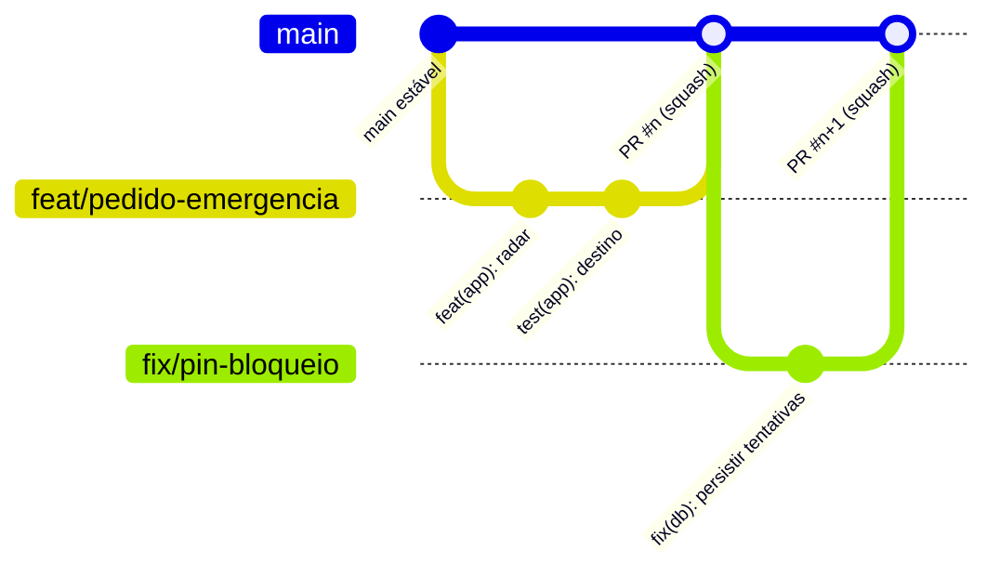

# Guia de Contribuição

Obrigado por contribuir com o Desperrengue. Este documento estabelece o **processo de engenharia** do projeto: fluxo de Git, padrão de *commits*, critérios de revisão, definição de pronto e regras específicas para banco de dados. Ele é **normativo**: o *pull request template* e o CI verificam parte destas regras.

Leituras prévias: [SETUP](../docs/SETUP.md) · [ARCHITECTURE](../docs/ARCHITECTURE.md) · [TESTING](../docs/TESTING.md) · [SECURITY](SECURITY.md) · [Código de Conduta](CODE_OF_CONDUCT.md).

## Sumário

1. [Princípios](#1-princípios)
2. [Fluxo de trabalho Git](#2-fluxo-de-trabalho-git)
3. [Padrão de *commits* (Conventional Commits)](#3-padrão-de-commits-conventional-commits)
4. [Pull requests e revisão de código](#4-pull-requests-e-revisão-de-código)
5. [Definição de Pronto (DoD)](#5-definição-de-pronto-dod)
6. [Padrões de código](#6-padrões-de-código)
7. [Regras para banco de dados e migrations](#7-regras-para-banco-de-dados-e-migrations)
8. [Segurança e segredos](#8-segurança-e-segredos)
9. [Código assistido por IA](#9-código-assistido-por-ia)
10. [Versionamento e *releases*](#10-versionamento-e-releases)
11. [Decisões de arquitetura (ADR)](#11-decisões-de-arquitetura-adr)

---

## 1. Princípios

1. **O banco é a fronteira de confiança** ([ADR-0003](../docs/adr/0003-regras-de-negocio-no-banco-via-rpc.md)); validações de UI são conveniência, não controle.
2. **Pequeno, frequente, reversível.** Mudanças pequenas e integradas com frequência reduzem risco e custo de revisão.
3. **Nada sem verificação.** Todo comportamento novo vem com teste ou, quando inviável, com evidência manual descrita no PR.
4. **Documentação é parte do produto.** O que muda o comportamento ou a arquitetura atualiza os documentos no mesmo PR.

---

## 2. Fluxo de trabalho Git

Adotamos **desenvolvimento baseado em tronco com ramos curtos** (*trunk-based development*), adequado a equipes pequenas:



| Regra | Detalhe |
| :-- | :-- |
| **`main`** | Sempre **implantável**. Proibido *push* direto; alterações só por PR com CI verde |
| **Ramos de trabalho** | Saem de `main` atualizada; vida curta (idealmente ≤ 3 dias); um propósito por ramo |
| **Nomenclatura** | `<tipo>/<descricao-curta-em-kebab-case>` com tipo ∈ `feat`, `fix`, `docs`, `refactor`, `test`, `perf`, `chore`, `ci`, `db` (ex.: `feat/carteira-profissional`, `db/limite-de-convites`) |
| **Integração** | `git pull --rebase origin main` antes de abrir/atualizar o PR (histórico linear) |
| **Merge** | **Squash and merge**, com a mensagem final no padrão da seção 3 |
| **Ramos de longa duração** | Evitar. Funcionalidades grandes entram **atrás de *flags*** ou em fatias verticais |
| **Hotfix** | Ramo `fix/…` a partir de `main`, PR expresso (revisão focada), *tag* de *patch* |
| **Remoção** | Apague o ramo após o *merge* |

---

## 3. Padrão de *commits* (Conventional Commits)

Formato [Conventional Commits 1.0.0](https://www.conventionalcommits.org/pt-br/v1.0.0/):

```
<tipo>(<escopo opcional>)<!>: <descrição no imperativo, minúscula, sem ponto final, ≤ 72 colunas>

<corpo opcional: o PORQUÊ, contexto, alternativas descartadas>

<rodapé opcional: BREAKING CHANGE: …, Refs #123, Closes #456>
```

| Tipo | Uso | Efeito no SemVer |
| :-- | :-- | :-- |
| `feat` | Nova funcionalidade | MINOR |
| `fix` | Correção de defeito | PATCH |
| `perf` | Melhoria de desempenho | PATCH |
| `refactor` | Reestruturação sem mudar comportamento | — |
| `docs` | Documentação | — |
| `test` | Testes | — |
| `build` / `ci` / `chore` | Dependências, pipeline, manutenção | — |
| `db` (escopo recomendado: `feat(db)`, `fix(db)`) | Migrations, políticas, funções SQL | conforme o impacto |

**Escopos sugeridos:** `app`, `db`, `edge`, `docs`, `ci`, `deps`, `auth`, `kyc`, `client`, `provider`.
**Quebra de compatibilidade:** sufixo `!` e rodapé `BREAKING CHANGE:` (ex.: remoção/renomeação de coluna ou RPC).

Exemplos:

```
feat(provider): exibir comissão de 12% ao digitar o orçamento
fix(db): persistir tentativas de PIN (rollback desfazia o contador)
feat(db)!: substituir profiles.role por flags is_client/is_provider

BREAKING CHANGE: clientes antigos que gravam role='client' passam a falhar.
```

> **Idioma:** descrições em **português do Brasil** (idioma do domínio e da equipe); identificadores de código e de banco em **inglês** ([ADR-0004](../docs/adr/0004-unificacao-de-perfis-e-nomes-em-ingles.md)). O histórico anterior a este guia não segue o padrão e **não será reescrito**.

---

## 4. Pull requests e revisão de código

### 4.1 Abertura

* Um PR = **uma mudança coesa** (preferencialmente < 400 linhas alteradas, excluídos arquivos gerados).
* Título no padrão Conventional Commits; preencha **todo** o [template](PULL_REQUEST_TEMPLATE.md).
* Vincule a *issue* (`Closes #n`). Anexe **capturas de tela/GIF** para mudanças de UI e **a saída do teste SQL** para mudanças de banco.
* Use PR em **rascunho** para pedir feedback antecipado.

### 4.2 Revisão

| Aspecto | Regra |
| :-- | :-- |
| **Revisores** | ≥ 1 aprovação. Com equipe de 2 pessoas: o **desenvolvedor** revisa o código; o **PO** valida o comportamento contra a especificação. Mudanças em **segurança/banco/dinheiro** exigem checklist completo e preferencialmente 2º par de olhos |
| **SLA** | Primeira resposta em até **2 dias úteis** |
| **Autor ≠ aprovador** | Ninguém aprova o próprio PR (exceção documentada: *hotfix* crítico com revisão posterior) |
| **Tom** | Comentários sobre o código, não sobre a pessoa ([Código de Conduta](CODE_OF_CONDUCT.md)); prefixos úteis: `nit:` (opcional), `pergunta:`, `bloqueante:` |
| **Resolução** | O autor responde a cada comentário; o revisor resolve a conversa |

### 4.3 O que o revisor verifica

1. **Corretude e requisitos** (RF/RNF correspondentes; casos de borda: lista vazia, erro de rede, concorrência).
2. **Segurança:** RLS/`GRANT` mínimos? Dado sensível em tabela adequada? Nenhuma chave no código? Entrada validada no **servidor**?
3. **Arquitetura:** respeita as camadas (`features → core`; só `services` conhece tabelas/RPCs); sem lógica de negócio na UI.
4. **Testes:** adequados ao risco; determinísticos; sem dependência de rede/relógio.
5. **UX:** estados de carregamento, erro e vazio; textos pt-BR; acessibilidade (contraste, alvos ≥ 48 dp).
6. **Dívida técnica:** nova dívida está registrada (TODO com *issue*) e justificada.
7. **Documentação:** CHANGELOG, README/ARCHITECTURE/ADR atualizados quando aplicável.

---

## 5. Definição de Pronto (DoD)

Um item só é considerado **pronto** quando:

- [ ] `flutter analyze` sem avisos e `flutter test` verdes (local **e** CI).
- [ ] Testes novos/atualizados cobrindo o comportamento (ver [TESTING](../docs/TESTING.md)).
- [ ] Mudança de banco: migration **ensaiada com `ROLLBACK`**, aplicada, registrada, e **todos** os testes SQL (`security_smoke`, `review_system_smoke`, `achievements_smoke`, `offboarding_showcase_smoke`, `client_wallet_smoke`) com `FALHAS=0` (saída anexada).
- [ ] Verificação manual em emulador/dispositivo para mudanças de UI (capturas no PR).
- [ ] Sem segredos, sem `print`/logs de dados pessoais.
- [ ] [CHANGELOG](../docs/CHANGELOG.md) atualizado na seção **Não lançado**.
- [ ] Documentação e, se estrutural, [ADR](../docs/adr/README.md). Novos `.md` entram em `docs/` (políticas da comunidade em `.github/`; a raiz fica só com `README.md` e `LICENSE.md`) e são listados em [docs/README.md](../docs/README.md); `node scripts/check-md-links.mjs` sem links quebrados.
- [ ] Revisão aprovada e conversas resolvidas.

---

## 6. Padrões de código

**Dart/Flutter**

* `dart format` obrigatório; lints `flutter_lints` (build falha em avisos no CI).
* Arquivos em `snake_case.dart`; tipos em `PascalCase`; membros privados com `_`.
* **Camadas:** `core/models` puro (sem Flutter/Supabase); `core/services` é a **única** camada que conhece tabelas, colunas e RPCs; telas não chamam `Supabase.instance` diretamente para regras de negócio.
* Preferir `const` e *widgets* pequenos e compostos; evitar lógica em `build`.
* Após `await`, verificar `if (!mounted) return;` antes de usar `context`.
* **Texto de interface em pt-BR**; datas e moeda via `core/utils/format.dart`.
* Erros ao usuário via `friendlyError`; nunca exibir exceções cruas.
* Estado de modo/tema: usar `AppSession`; decisões de navegação pós-login **somente** em `destinationFor`.

**SQL (PostgreSQL)**

* Identificadores em inglês, `snake_case`; tabelas no plural.
* Funções de domínio: `SECURITY DEFINER`, `SET search_path = public`, `REVOKE ALL … FROM public, anon`, `GRANT EXECUTE … TO authenticated`.
* `CHECK` para domínios de estado; FKs com a política de exclusão explícita.
* Comentário de cabeçalho na migration explicando o **porquê**.

**TypeScript/Deno (Edge Functions):** validar entrada, falhar fechado (401/4xx), não registrar segredos.

---

## 7. Regras para banco de dados e migrations

1. **Fonte da verdade:** `supabase/migrations/`. Mudança feita só no dashboard é **inválida** — reproduza-a em migration.
2. **Nome:** `AAAAMMDDHHMMSS_descricao_curta.sql`; **uma transação** (`BEGIN … COMMIT`).
3. **Imutabilidade:** migration **aplicada** não se edita; corrige-se com **nova** migration.
4. **Ensaio obrigatório:** execute uma cópia com `COMMIT` → `ROLLBACK` antes de aplicar:

   ```bash
   supabase db query --linked -f <arquivo_com_rollback>.sql
   ```
5. **Aplicação** e **registro**:

   ```bash
   supabase db query --linked -f supabase/migrations/<arquivo>.sql
   supabase db query --linked "insert into supabase_migrations.schema_migrations(version,name) values ('<AAAAMMDDHHMMSS>','<nome>') on conflict do nothing;"
   ```
6. **Backup lógico** antes de migrations destrutivas (`DROP`, `UPDATE` em massa).
7. **Teste:** estenda `supabase/tests/security_smoke.sql` para cada nova regra de negócio/segurança; **toda nova tabela** deve ter RLS e pelo menos um teste de acesso negado.
8. **Dinheiro:** valores novos em **centavos inteiros** (`bigint`), nunca `float`/`double`; movimentação de saldo **só pelo ledger** (`_ledger_post`: cada transação soma zero, `idempotency_key` única) — nunca `UPDATE` direto em `client_wallets` ([ADR-0018](../docs/adr/0018-carteira-ledger-e-pix-sandbox.md)).
8. **Compatibilidade:** mudanças que quebram clientes publicados exigem estratégia de transição (colunas/RPCs antigas mantidas por uma versão) ou `BREAKING CHANGE` explícito.
9. **Dinheiro e estado** só mudam por RPC; nunca conceda `UPDATE` direto em `status`, `payment_status`, `verification_status`, notas ou contadores.

---

## 8. Segurança e segredos

* **Nunca** versione `service_role`, senhas, `RESEND_API_KEY`, tokens pessoais (PAT) ou `.env` com valores reais.
* A única chave no app é a ***publishable key*** (pública por design).
* Tokens temporários de operação devem ter **escopo mínimo, validade curta e ser revogados** ao final.
* Vulnerabilidades: **não abra *issue* pública** — siga o [SECURITY.md](SECURITY.md).

---

## 9. Código assistido por IA

O projeto é desenvolvido com **programação em par assistida por IA**. Regras:

1. O(a) autor(a) do PR **responde pelo código** como se o tivesse escrito; leia e entenda cada linha.
2. **Não cole segredos ou dados pessoais reais** em ferramentas de IA.
3. Código gerado **passa pelos mesmos critérios**: testes, revisão e DoD. Verifique APIs e versões de bibliotecas (a IA pode alucinar métodos).
4. Prefira que a IA proponha **testes** e **ensaios** (ex.: transação com `ROLLBACK`) antes de qualquer mudança em dados.

---

## 10. Versionamento e *releases*

* **SemVer 2.0.0** (`MAJOR.MINOR.PATCH`); enquanto `MAJOR = 0`, mudanças incompatíveis incrementam `MINOR`.
* Processo: (1) mover **Não lançado** para a nova seção do [CHANGELOG](../docs/CHANGELOG.md); (2) atualizar `version:` no `app/pubspec.yaml`; (3) *commit* `chore(release): vX.Y.Z`; (4) *tag* anotada `git tag -a vX.Y.Z -m "…"` e `git push --tags`; (5) notas de versão no GitHub *Releases*.
* O *build number* (`+N`) do `pubspec` incrementa a cada envio às lojas.

---

## 11. Decisões de arquitetura (ADR)

Mudanças que **afetam estrutura, segurança, dados ou contratos entre camadas** exigem um [ADR](../docs/adr/README.md) no mesmo PR (copie `docs/adr/0000-modelo.md`). ADRs aceitos são imutáveis; para mudar, crie um novo que os **supere**.
