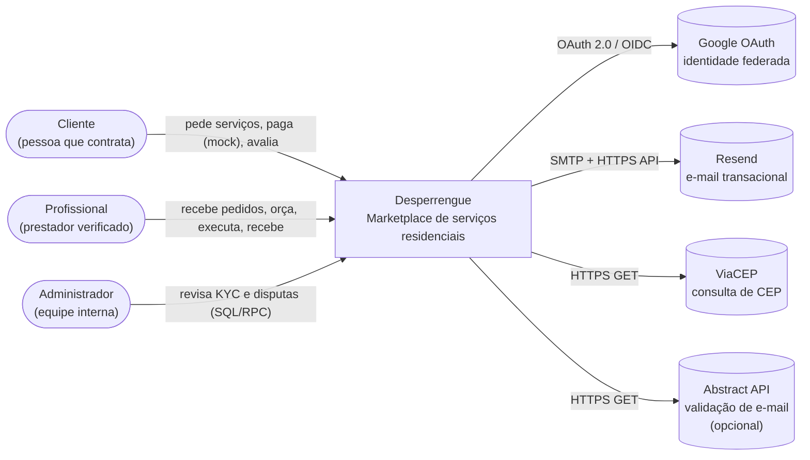
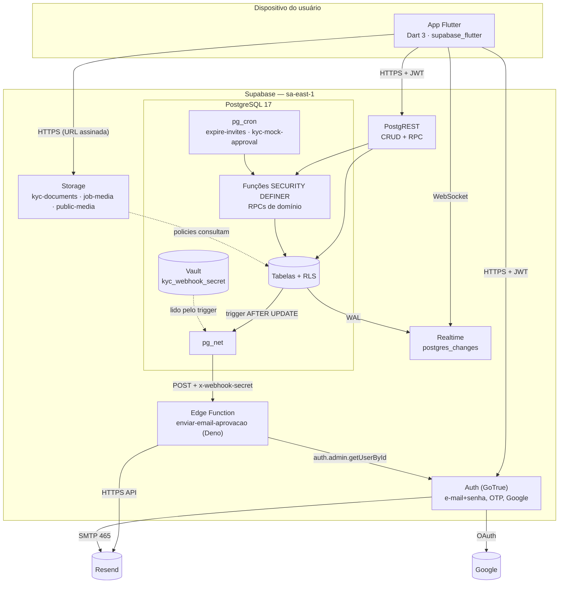
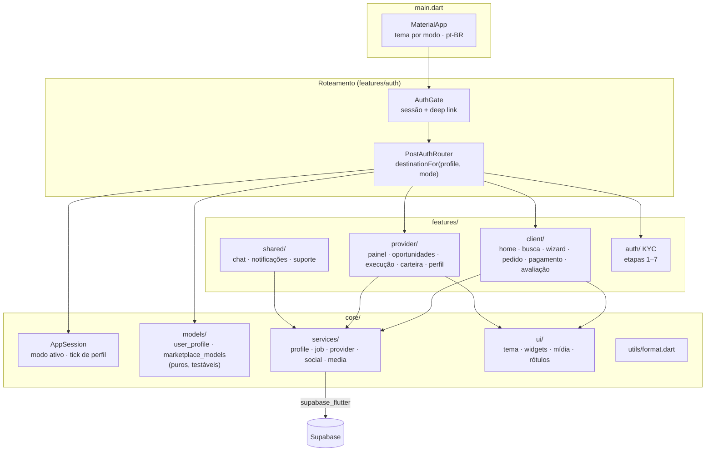
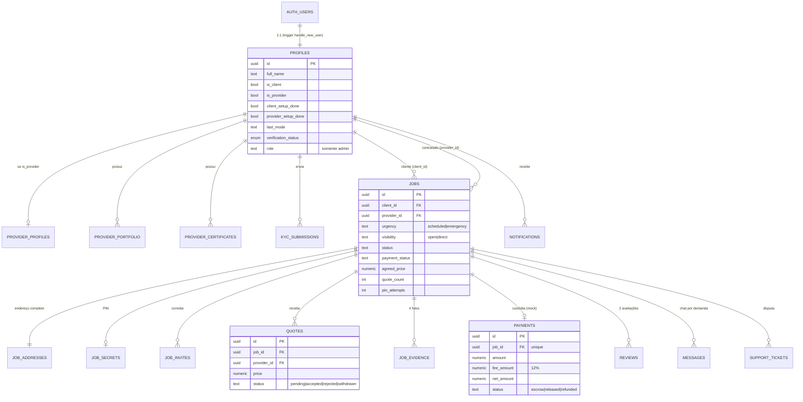
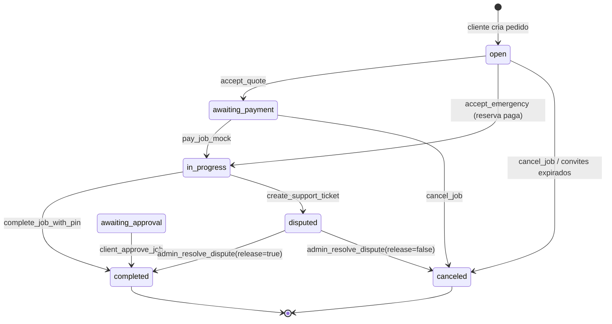
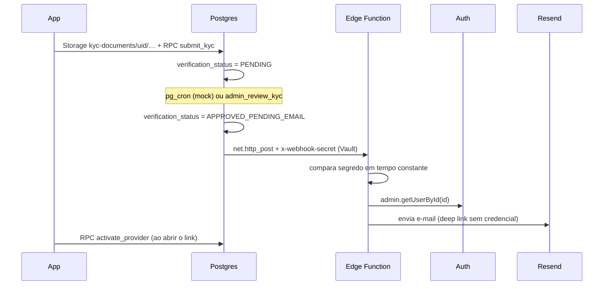
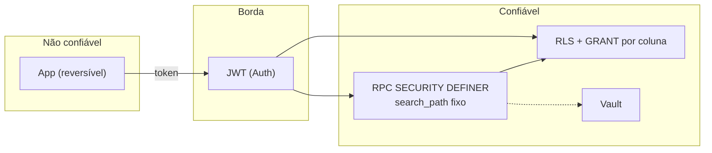

# ARCHITECTURE — Desperrengue

> **Escopo.** Descrição macro da arquitetura do sistema Desperrengue (marketplace de serviços residenciais), seus componentes, fluxos de dados, invariantes de segurança e decisões estruturais. Decisões individuais, com contexto e alternativas, estão registradas nos [ADRs](adr/README.md).
> **Estado do documento.** Reflete o código da branch `fix/foundation-hardening` (migrations `20261009120000` a `20261019160000`). Onde a implementação difere do alvo arquitetural, a lacuna é declarada explicitamente na seção [12](#12-lacunas-conhecidas-e-dívida-técnica).

## Sumário

1. [Visão geral e estilo arquitetural](#1-visão-geral-e-estilo-arquitetural)
2. [Contexto do sistema (C4 — nível 1)](#2-contexto-do-sistema-c4--nível-1)
3. [Contêineres (C4 — nível 2)](#3-contêineres-c4--nível-2)
4. [Aplicativo móvel (C4 — nível 3)](#4-aplicativo-móvel-c4--nível-3)
5. [Modelo de dados](#5-modelo-de-dados)
6. [Máquinas de estado](#6-máquinas-de-estado)
7. [Fluxos de dados críticos](#7-fluxos-de-dados-críticos)
8. [Modelo de segurança](#8-modelo-de-segurança)
9. [Tempo real, jobs agendados e integrações](#9-tempo-real-jobs-agendados-e-integrações)
10. [Implantação e ambientes](#10-implantação-e-ambientes)
11. [Atributos de qualidade](#11-atributos-de-qualidade)
12. [Lacunas conhecidas e dívida técnica](#12-lacunas-conhecidas-e-dívida-técnica)

---

## 1. Visão geral e estilo arquitetural

O Desperrengue é um sistema **cliente–servidor de duas camadas lógicas** sobre um **BaaS (Backend-as-a-Service)**:

* **Cliente:** um único aplicativo móvel Flutter (Android e iOS) que hospeda **dois modos de uso** — *Cliente* e *Profissional* — sobre a mesma conta de usuário.
* **Servidor:** o projeto Supabase `eisfkemgooqbgqljvwvs` (região `sa-east-1`, PostgreSQL 17), que concentra autenticação, banco relacional, armazenamento de objetos, canais de tempo real, funções de borda e agendamento (`pg_cron`).

Não existe servidor de aplicação próprio. O estilo é, portanto, **"banco como núcleo de domínio"** (*database-centric architecture*): as **invariantes de negócio** — limite de três orçamentos, custódia de pagamento, transições de estado, privacidade de endereço e do PIN — são impostas por **políticas RLS (*Row Level Security*), *triggers* e funções `SECURITY DEFINER`**, e não pelo cliente. O aplicativo é tratado como **componente não confiável** (zero-trust no cliente): qualquer verificação feita na UI é apenas ergonomia, nunca controle de acesso ([ADR-0003](adr/0003-regras-de-negocio-no-banco-via-rpc.md)).

| Princípio | Materialização |
| :-- | :-- |
| *Single source of truth* do esquema | `supabase/migrations/` (versionadas, ordenadas, idempotentes quando possível) |
| Menor privilégio | `REVOKE` total + `GRANT` por coluna; RLS `TO authenticated`; `anon` sem acesso |
| Transições de estado atômicas | RPCs com `SELECT … FOR UPDATE` e *advisory locks* |
| Minimização de dados | Views públicas mínimas; endereço em tabela separada; PIN em tabela com política de dono |
| Observabilidade do domínio | Notificações geradas no servidor; `notifications` + Realtime |
| Verificabilidade | Testes SQL transacionais com 162 asserções (segurança 62, avaliações 30, conquistas 22, carteira/exclusão/vitrine 48) ([TESTING](TESTING.md)) |

---

## 2. Contexto do sistema (C4 — nível 1)



**Observação de fronteira.** O gateway de pagamento é **simulado** (MVP acadêmico): nenhum dado de cartão trafega e nenhuma cobrança real ocorre ([ADR-0006](adr/0006-pagamento-mock-com-custodia-e-pin.md)).

---

## 3. Contêineres (C4 — nível 2)



| Contêiner | Tecnologia | Responsabilidade |
| :-- | :-- | :-- |
| App | Flutter 3.47 / Dart ^3.13 | UI, estado local de sessão e modo, orquestração de chamadas |
| Auth | GoTrue | Identidade, OTP de cadastro, OAuth Google, emissão de JWT |
| PostgREST | — | Exposição segura do esquema `public` conforme RLS e `GRANT` |
| Banco | PostgreSQL 17 | Persistência, invariantes, regras de negócio, agendamento |
| Realtime | Supabase Realtime | Difusão de mudanças (`jobs`, `quotes`, `job_invites`, `messages`, `notifications`) |
| Storage | S3-compatível | Documentos de KYC, fotos de pedido/evidência, mídia pública |
| Edge Function | Deno | Envio do e-mail de aprovação do KYC (autenticada por segredo compartilhado, [ADR-0010](adr/0010-webhook-autenticado-por-segredo-no-vault.md)) |
| Edge Function `excluir-conta` | Deno + `pdf-lib` | Offboarding LGPD: valida o JWT do usuário, gera o Dossiê PDF, envia (Resend) e só então apaga dados e conta ([ADR-0013](adr/0013-exclusao-de-conta-lgpd-e-dossie.md)) |
| Abertura do app | Flutter | Splash nativa + animada, init paralela, sessão no Keystore, último perfil ([ADR-0015](adr/0015-abertura-do-app-splash-init-e-sessao-segura.md)) |
| Tema | Flutter + Riverpod | Tokens semânticos, tri-state claro/escuro/automático ([ADR-0014](adr/0014-design-tokens-e-modo-escuro.md)) |

---

## 4. Aplicativo móvel (C4 — nível 3)



**Regras de dependência (impostas por convenção e revisão):**

1. `features/*` depende de `core/*`; **`core/*` nunca importa `features/*`**.
2. **Somente `core/services/*` conhece nomes de tabelas, colunas e RPCs.** Telas consomem modelos de domínio.
3. `core/models/*` é **Dart puro** (sem Flutter/Supabase) — pré-condição para testes unitários rápidos.
4. A decisão "para onde navegar após autenticar" é **função pura** `destinationFor(profile, mode, forceSelection)`, coberta por testes.

**Modo ativo e tema.** `AppSession` (em memória) guarda o modo escolhido na sessão. O `PostAuthRouter` deriva o destino e sincroniza `AppSession.theme`, que o `MaterialApp` observa — assim o tema (laranja/cliente, azul/profissional) vale também para telas empilhadas por `Navigator.push`.

**Atualização reativa.** `ClientJobScreen` e `ProviderJobScreen` assinam o registro do pedido (`stream`) e **trocam de tela conforme o estado** (aguardando orçamento → pagamento → execução → conclusão), eliminando navegação imperativa frágil entre estados.

---

## 5. Modelo de dados

### 5.1 Diagrama entidade–relacionamento (núcleo)



### 5.2 Decisões de modelagem relevantes

| Tema | Decisão | Justificativa |
| :-- | :-- | :-- |
| Multi-modo | Flags `is_client` / `is_provider` em vez de `role` único | Uma pessoa exerce os dois papéis; evita duplicar contas ([ADR-0005](adr/0005-modelo-multi-modo-por-flags.md)) |
| Perfil | Tabela única `profiles` (nomes em inglês) | Havia duas tabelas divergentes (`perfis`/`profiles`) ([ADR-0004](adr/0004-unificacao-de-perfis-e-nomes-em-ingles.md)) |
| Endereço | `job_addresses` separada de `jobs` | RLS por *linha* não oculta *coluna*; separar aplica privacidade por contratação ([ADR-0007](adr/0007-privacidade-por-minimizacao-de-dados.md)) |
| PIN | `job_secrets` com política "só dono" | O profissional valida via RPC e nunca lê o segredo |
| Reputação | `rating_avg`, `rating_count`, `jobs_done` protegidos por *trigger* | Impede inflar a própria nota |
| Valores monetários | `numeric` (exato), comissão fixa de 12 % calculada no servidor | Evita erros de ponto flutuante; regra única |
| Integridade | FKs com `ON DELETE CASCADE` para dados do usuário; `CHECK` para domínios de estado | Consistência e LGPD (eliminação) |

---

## 6. Máquinas de estado

### 6.1 Pedido (`jobs.status`)



`awaiting_approval` é um estado reservado (RPCs `provider_finish_job` e `client_approve_job` existem), **não utilizado** pelo fluxo atual, que conclui diretamente por PIN.

### 6.2 Pagamento (`jobs.payment_status` / `payments.status`)

| Evento | `pending` | `escrow` | `released` | `refunded` |
| :-- | :-: | :-: | :-: | :-: |
| Pedido criado | ● | | | |
| `pay_job_mock` / `request_emergency_mock` | | ● | | |
| `complete_job_with_pin` | | | ● | |
| Cancelamento/expiração com reserva; disputa resolvida a favor do cliente | | | | ● |

### 6.3 Verificação do profissional (`profiles.verification_status`)

`NOT_SUBMITTED → PENDING → APPROVED_PENDING_EMAIL → ACTIVE`, com `REJECTED` permitindo reenvio. Somente `ACTIVE` habilita enviar orçamentos e aparecer na busca.

---

## 7. Fluxos de dados críticos

### 7.1 Ciclo completo do serviço agendado

```mermaid
sequenceDiagram
    autonumber
    actor C as Cliente
    participant A as App
    participant DB as Postgres (RPC + RLS)
    participant RT as Realtime
    actor P as Profissional

    C->>A: descreve, anexa fotos, escolhe data e profissional
    A->>DB: Storage: upload (job-media/uid/…)
    A->>DB: INSERT jobs + job_addresses
    A->>DB: RPC invite_providers(job, [P])
    DB-->>P: notifications (novo convite) via RT
    P->>A: abre o chamado (fotos por URL assinada)
    A->>DB: INSERT quotes (trigger: limite 3, convite válido)
    DB-->>C: notifications + quote_count via RT
    C->>A: compara e aceita
    A->>DB: RPC accept_quote (FOR UPDATE; rejeita os demais)
    C->>A: confirma pagamento simulado
    A->>DB: RPC pay_job_mock (payments=escrow; gera PIN)
    P->>A: executa; captura 4 fotos
    A->>DB: INSERT job_evidence (RLS: só o contratado)
    P->>A: digita o PIN informado pelo cliente
    A->>DB: RPC complete_job_with_pin
    DB-->>DB: valida PIN, libera escrow, jobs_done++
    DB-->>C: notifications (concluído) via RT
    C->>A: avalia; P avalia o cliente
    A->>DB: RPC submit_review (avaliação cega: revela com as 2 partes ou em 48 h; recalcula reputação e conquistas)
```

### 7.2 Aprovação do KYC e e-mail



### 7.3 Emergência

O cliente **paga a reserva da visita antes** do aceite; o profissional tem 5 minutos. Aceite → `in_progress` com PIN gerado. Recusa ou expiração (`pg_cron expire-invites`, 1/min) → `canceled` e `payments.status = refunded`. O cancelamento pelo cliente também estorna. Essas invariantes são verificadas pelos itens 52–57 do teste de fumaça.

---

## 8. Modelo de segurança

### 8.1 Fronteiras de confiança



### 8.2 Matriz de controle de acesso (resumo)

| Dado | Dono | Contratado | Convidado/Orçou | Profissional ativo | Outro usuário | `anon` |
| :-- | :-: | :-: | :-: | :-: | :-: | :-: |
| Pedido aberto (`visibility=open`) | ✔ | ✔ | ✔ | ✔ (leitura) | ✖ | ✖ |
| Pedido direto | ✔ | ✔ | ✔ (convidado) | ✖ | ✖ | ✖ |
| Endereço completo | ✔ | ✔ | ✖ | ✖ | ✖ | ✖ |
| PIN | ✔ | ✖ (só valida) | ✖ | ✖ | ✖ | ✖ |
| Orçamento | ✔ (todos) | ✔ (o seu) | ✔ (o seu) | ✖ | ✖ | ✖ |
| Fotos do pedido (storage) | ✔ | ✔ | ✔ | ✔ (aberto) | ✖ | ✖ |
| Evidências | ✔ (leitura) | ✔ | ✖ | ✖ | ✖ | ✖ |
| Mensagens | ✔ | ✔ | ✔ (a sua conversa) | ✖ | ✖ | ✖ |
| Documentos de KYC | próprio/admin | — | — | — | ✖ | ✖ |

### 8.3 Ameaças endereçadas e controles

| Ameaça (STRIDE) | Controle |
| :-- | :-- |
| **S**poofing do webhook de e-mail | `x-webhook-secret` no Vault; comparação em tempo constante; e-mail obtido por `auth.admin`, nunca do *payload* |
| **T**ampering: auto-aprovação de KYC, escalada de papel, inflar nota | `GRANT UPDATE` por coluna + *triggers* `profiles_protect_columns` / `provider_profiles_protect` |
| **T**ampering: alterar `status`/`payment_status` | Sem `UPDATE` direto; apenas RPCs |
| **R**epudiation | `notifications`, `payments`, `reviews`, `support_tickets` com *timestamps*; fotos de evidência |
| **I**nformation disclosure: endereço/PIN/KYC | Tabelas separadas, RLS por dono, *buckets* privados, URLs assinadas |
| **D**oS lógico: spam de orçamentos | Limite de 3, 1 por profissional, *advisory lock*; convites limitados a 3 |
| **E**levation: função `SECURITY DEFINER` | `SET search_path = public`; `REVOKE ALL … FROM public, anon`; `GRANT` explícito a `authenticated` |
| Força bruta no PIN | 5 tentativas **persistidas** (a tentativa não é desfeita por rollback) |

Política de divulgação de vulnerabilidades: [SECURITY.md](../.github/SECURITY.md).

---

## 9. Tempo real, jobs agendados e integrações

| Mecanismo | Uso |
| :-- | :-- |
| `supabase_realtime` (publicação) | `jobs`, `quotes`, `job_invites`, `messages`, `notifications` — o app usa `.stream()`; a RLS é respeitada pelo Realtime |
| `pg_cron` — `expire-invites` (1/min) | Expira convites; estorna emergências sem resposta |
| `pg_cron` — `kyc-mock-approval` (1/min) | **Mock** de aprovação do KYC após 40 s (`app_settings.kyc_auto_approve`); desligar em produção |
| `pg_net` | *Webhook* do banco para a Edge Function |
| Resend | SMTP do Auth (`smtp.resend.com:465`, remetente `suporte@desperrengue.tech`) e API da Edge Function |
| ViaCEP | Preenchimento de endereço por CEP (cliente HTTP direto do app) |
| Abstract API | Validação opcional de e-mail no cadastro (`--dart-define`) |

---

## 10. Implantação e ambientes

| Aspecto | Estado |
| :-- | :-- |
| Ambientes | **Um** projeto Supabase compartilhado (desenvolvimento = produção do MVP); sem *staging* |
| Aplicação de migrations | `supabase db query --linked -f <arquivo>` (sem Docker) + registro manual em `supabase_migrations.schema_migrations`; *dry-run* em transação com `ROLLBACK` antes de aplicar |
| Edge Function | `supabase functions deploy enviar-email-aprovacao --use-api --no-verify-jwt` |
| App | Builds locais (`flutter run`); sem pipeline de distribuição |
| CI | GitHub Actions: `flutter analyze` + `flutter test` ([`.github/workflows/ci.yml`](../.github/workflows/ci.yml)) |
| Segredos | Fora do repositório; ver [SETUP](SETUP.md) e [SECURITY](../.github/SECURITY.md) |

Configuração remota de Auth relevante (verificada): confirmação de e-mail **ligada**, OTP de 6 dígitos com validade de 10 min, SMTP via Resend, Google habilitado, *redirect URLs* `br.com.desperrengue.app://login-callback` e `desperrengue://onboarding/ativar`. Observação: `supabase/config.toml` local mantém `enable_confirmations = false` (somente para o ambiente local do CLI).

---

## 11. Atributos de qualidade

Mapeamento aos atributos da ISO/IEC 25010:

| Característica | Táticas arquiteturais |
| :-- | :-- |
| **Segurança** (confidencialidade, integridade, não repúdio) | RLS, `GRANT` por coluna, RPCs, Vault, URLs assinadas, evidências (§8) |
| **Confiabilidade** (maturidade, recuperabilidade) | Invariantes atômicas; estorno automático; `pg_cron`; *backup* manual antes de migrações destrutivas |
| **Adequação funcional** | Telas derivadas de protótipos hi-fi; spec em [`docs/specs`](specs) |
| **Manutenibilidade** (modularidade, testabilidade) | Camadas `core/features`, modelos puros, serviços isolados, migrations versionadas |
| **Usabilidade** | Design system por modo, estados de carregamento/erro/vazio padronizados, textos em pt-BR |
| **Eficiência de desempenho** | Índices parciais (`jobs_open_idx`), `quote_count` desnormalizado, URLs assinadas com cache |
| **Portabilidade** | Flutter multiplataforma; Supabase portável (PostgreSQL padrão) |
| **Compatibilidade** | Esquemas de URL (deep links) Android/iOS |

---

## 12. Lacunas conhecidas e dívida técnica

| ID | Lacuna | Impacto | Plano |
| :-- | :-- | :-- | :-- |
| DT-01 | Ambiente único (sem *staging*) | Risco ao aplicar migrations | Criar projeto de *staging* e pipeline de migrations ([ROADMAP](ROADMAP.md)) |
| DT-02 | Navegação com `Navigator` + `AuthGate`; `go_router` e `flutter_riverpod` declarados, pouco usados | Deep links por rota e *state management* limitados | Migrar para `go_router` + Riverpod |
| DT-03 | Cobertura de testes restrita às camadas puras e ao banco | Regressões de UI não detectadas | Testes de *widget* e `integration_test` |
| DT-04 | Pagamento simulado | Sem fluxo financeiro real | Integrar gateway (Pix/cartão) com *webhooks* assinados |
| DT-05 | Aprovação de KYC automática (mock) | Verificação não efetiva em produção | Fila de revisão administrativa |
| DT-06 | Bucket legado `kyc_documentos` (privado, 19 objetos de teste) | Resíduo | Remoção após confirmação |
| DT-07 | Sem *push notifications* | Avisos só dentro do app | FCM/APNs |
| DT-08 | Aprovação por PIN sem biometria/QR | Atrito em campo | Leitura de QR do PIN |
