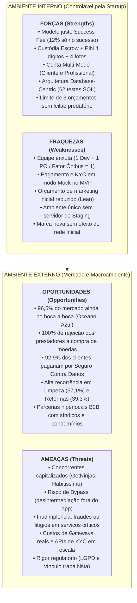

# Análise de Ambientes e Matriz SWOT — Desperrengue

> **Escopo:** Este documento apresenta a análise estratégica de ambientes (Macroambiente PESTEL, Microambiente Setorial e Matriz SWOT / FOFA) da startup **Desperrengue**, fundamentada nos dados empíricos coletados na Pesquisa de Mercado do projeto ($N = 46$ respondentes), no [Documento de Contexto](./Documento%20de%20Contexto.md), no [Plano de Negócio e Tributação](./Planos%20de%20Negocio%20e%20Tributação.md) e no mapeamento de riscos técnicos do [ROADMAP](ROADMAP.md).

---

## 1. Análise do Macroambiente (Fatores Externos — PESTEL)

A análise macroambiental avalia as forças externas sobre as quais a startup não possui controle direto, mas que geram oportunidades ou ameaças estratégicas:

| Dimensão | Fator Identificado | Impacto no Desperrengue |
| :--- | :--- | :--- |
| **Político-Legal** | **LGPD (Lei nº 13.709/2018)** e regulamentação de intermediação digital (CNAE `7490-1/04` no Simples Nacional). | Exige proteção rigorosa de documentos sensíveis de KYC (RG, CNH, selfie) e endereços residenciais — mitigada nativamente na arquitetura via buckets privados, URLs assinadas e tabelas segregadas ([ADR-0007](./adr/0007-privacidade-por-minimizacao-de-dados.md)). |
| **Econômico** | Crescimento do trabalho autônomo/MEI no Brasil (44,4% dos prestadores da nossa pesquisa buscam renda extra e 55,6% têm os serviços como renda principal) e consolidação do **Pix**. | Favorece a adesão de novos profissionais à plataforma e barateia a liquidação financeira dos pagamentos em custódia (*Escrow*). |
| **Sociocultural** | Verticalização urbana (condomínios), rotinas corridas e **alta sensação de insegurança pública**. Na nossa pesquisa, **60,7% dos clientes** apontaram o medo de colocar um estranho em casa como sua maior barreira. | Cria forte demanda por uma plataforma cujo diferencial central seja a **verificação de identidade (KYC)**, avaliações verificadas e liberação presencial por **PIN**. |
| **Tecnológico** | Maturidade de plataformas *Backend-as-a-Service* (Supabase PostgreSQL 17), frameworks multiplataforma (Flutter) e APIs de verificação biométrica/documental. | Permite operar o MVP no **Cenário Lean** com custo fixo de infraestrutura inferior a R$ 600/mês, mantendo segurança de nível bancário via RLS. |

---

## 2. Análise do Microambiente e Concorrência

O mercado brasileiro de serviços residenciais é caracterizado por uma paradoxal **baixa digitalização efetiva**. Nossa pesquisa de mercado revelou que:
* **96,5% dos clientes** ainda contratam exclusivamente por meios analógicos/informais (**78,6% via indicação boca a boca** de amigos/familiares e **17,9% via grupos de WhatsApp/Facebook** de condomínio).
* Apenas **3,6% utilizam aplicativos atuais** (como GetNinjas, Habitissimo ou Triider).
* **100% dos profissionais entrevistados rejeitam o modelo de "venda de leads/moedas"** praticado pelos concorrentes tradicionais, onde o trabalhador paga apenas para desbloquear o contato de "clientes fantasmas" (principal dor de 55,6% dos prestadores).

### Comparativo Estratégico (Benchmarking)

| Critério | Concorrentes Tradicionais (Ex: GetNinjas) | Grupos de WhatsApp / Boca a Boca | **Desperrengue (Nossa Proposta)** |
| :--- | :--- | :--- | :--- |
| **Modelo de Cobrança ao Profissional** | Venda de moedas/pacotes por orçamento enviado (sem garantia de retorno). | Gratuito, porém limitado ao círculo social. | **100% Gratuito para orçar.** Comissão (*Take Rate* de 12–15%) **apenas se o serviço for concluído** (*Success Fee*). |
| **Volume de Propostas** | Leilão aberto (dezenas de contatos simultâneos e guerra de preços). | Escasso e lento em emergências. | **Oferta Direcionada:** limite estrito de **no máximo 3 orçamentos** por demanda. |
| **Segurança e Triagem (KYC)** | Básica / autodeclaratória na maioria das categorias. | Baseada na confiança pessoal de quem indicou. | **KYC em 7 etapas** (RG frente/verso, selfie ao vivo e registro CREA/CFT/CNPJ). |
| **Garantia Contra Calotes** | Negociação direta por fora do app (alto risco de adiantamento e abandono). | Nenhuma garantia formal. | **Pagamento em Custódia (*Escrow*)** + **4 Fotos de Evidência** + **PIN de 4 dígitos** do cliente + Mediação. |

---

## 3. Matriz SWOT (FOFA) — Desperrengue

Abaixo apresenta-se a Matriz SWOT consolidada, cruzando o **Ambiente Interno** (Forças e Fraquezas da startup e do código atual) com o **Ambiente Externo** (Oportunidades e Ameaças do mercado):

---

### 3.1. Detalhamento do Ambiente Interno

#### 💪 Forças (*Strengths*)
1. **Alinhamento Total de Interesses (*Success Fee*):** Zero custo de entrada ou de envio de orçamento para o profissional; a plataforma só retém comissão (12% implementados nas RPCs, ajustável até 15%) quando o serviço é efetivamente executado e pago.
2. **Mecanismo Triplo de Confiança e Antifraude:** Combinação única de (i) verificação documental e biométrica (KYC), (ii) retenção financeira em custódia (*Escrow*) com **4 fotos obrigatórias de evidência** e (iii) liberação do pagamento somente mediante **PIN presencial de 4 dígitos** do cliente.
3. **Arquitetura *Database-Centric* Robusta e Verificada:** Regras de negócio críticas blindadas no PostgreSQL 17 via RLS, *triggers* e 16 RPCs `SECURITY DEFINER`, auditadas continuamente por **62 asserções automatizadas de segurança** (`security_smoke.sql`) e **36 testes unitários** no Flutter.
4. **Experiência Multi-Modo Unificada e Hiperlocal:** Uma única conta permite contratar e prestar serviços com tematização visual adaptativa (Laranja/Azul), preenchimento automático de endereço (ViaCEP/GPS) e modalidade de **Emergência ("Para Agora")** com estorno automático em 5 minutos.
5. **Enquadramento Tributário Otimizado:** Operação modelada como intermediação de negócios (CNAE `7490-1/04` no Simples Nacional), tributando apenas a comissão da plataforma (*Take Rate*) e não o valor integral do serviço (GMV).

#### ⚠️ Fraquezas (*Weaknesses*)
1. **Equipe Reduzida (*Bus Factor* = 1):** Estrutura inicial composta por 1 Desenvolvedor e 1 Product Owner em regime *Sweat Equity*, limitando a velocidade de atendimento manual de suporte e revisão documental em larga escala.
2. **Fluxos Financeiro e de KYC Simulados no Estágio MVP:** Conforme documentado em [`SECURITY.md`](../.github/SECURITY.md) e no [ROADMAP](ROADMAP.md) (DT-04 e DT-05), o checkout financeiro e a aprovação de KYC operam em modo simulado (*mock*) para fins de validação acadêmica, exigindo integração com gateway real (Pix/Stripe/Pagar.me) antes do lançamento comercial.
3. **Limitação de Verba Publicitária Inicial:** No cenário Lean (R$ 400 a R$ 600/mês), a aquisição depende fortemente de tráfego orgânico e parcerias locais, sem capital para campanhas massivas de mídia.
4. **Dívidas Técnicas Conhecidas de Infraestrutura:** Operação atual em ambiente único no Supabase (sem ambiente de *staging* separado — DT-01) e ausência temporária de notificações *push* externas via FCM/APNs (DT-07).

---

### 3.2. Detalhamento do Ambiente Externo

#### 🚀 Oportunidades (*Opportunities*)
1. **Oceano Azul de Digitalização (96,5% fora dos apps):** Quase a totalidade dos consumidores pesquisados ainda depende de indicações informais (78,6%) ou grupos de WhatsApp (17,9%) por falta de confiança nas plataformas existentes.
2. **Insatisfação Generalizada da Oferta (100% de Rejeição ao Modelo de Leads):** Profissionais qualificados estão ávidos por migrar para uma plataforma que não cobre por "clientes fantasmas", reduzindo drasticamente o Custo de Aquisição de Profissionais (CAC da oferta).
3. **Monetização Cruzada (*Cross-Sell*) com Seguro Contra Danos (92,9% de Aceitação):** A pesquisa de mercado comprovou que 92,9% dos clientes aceitam pagar uma taxa extra em troca de uma apólice/garantia contra danos residenciais, criando uma segunda fonte de receita de alta margem.
4. **Expansão para Categorias de Alta Recorrência:** A inclusão de **Limpeza / Diarista** (demandada por 57,1% dos clientes da pesquisa, com 42,8% contratando semanal ou mensalmente) aumenta a frequência de uso (*LTV*) ao lado dos serviços de elétrica, hidráulica e reformas.
5. **Parcerias Hiperlocais B2B com Condomínios e Administradoras:** Atuar em nichos geográficos fechados (bairros e condomínios parceiros) resolve o "problema do ovo e da galinha" (*Marketplace Liquidity*) com baixo custo de marketing.

#### 🛡️ Ameaças (*Threats*)
1. **Risco de Desintermediação (*Bypass* / "Fechar por Fora"):** Após conhecer um bom profissional ou trocar contatos, cliente e prestador podem tentar negociar os próximos serviços diretamente fora do aplicativo para evitar a comissão de 12–15%.
2. **Reação de Concorrentes Estabelecidos:** Plataformas de grande porte (GetNinjas, Habitissimo) possuem alto caixa e reconhecimento de marca nacional.
3. **Custos Transacionais de Gateways e KYC Automatizado:** Na fase de escala, taxas de *split* de pagamento (3% a 5%) e APIs comerciais de checagem de antecedentes (ex.: idwall, CAF) podem comprimir a margem líquida se o *Take Rate* não for bem calibrado.
4. **Riscos Jurídicos e Operacionais em Campo:** Acidentes domésticos, danos materiais durante o reparo ou tentativas de reconhecimento de vínculo empregatício exigem Termos de Uso robustos, mediação ágil e seguro parceiro.

---

## 4. Matriz SWOT Cruzada (Plano de Ação Estratégico)

O cruzamento dos quadrantes define as quatro diretrizes estratégicas da startup:

| Cruzamento | Estratégia Formuladas para o Desperrengue |
| :--- | :--- |
| **Ofensiva (Forças $\times$ Oportunidades)** *Alavancar vantagens para dominar o mercado* | **Estratégia "Bairro Seguro":** Usar o modelo *Zero Custo por Orçamento* + *Custódia por PIN* (Forças) para atrair rapidamente os melhores eletricistas, encanadores e diaristas locais (100% insatisfeitos com os concorrentes) e fechar parcerias com síndicos de condomínios (Oportunidade), convertendo os 96,5% que hoje usam grupos de WhatsApp. |
| **Confronto (Forças $\times$ Ameaças)** *Usar forças para blindar contra ameaças* | **Combate ao *Bypass* via Proteção e Portfólio:** Desestimular o "fechamento por fora" (Ameaça) condicionando o **Pagamento Garantido em Custódia**, o **Seguro Contra Danos**, o histórico de **4 fotos no Portfólio Verificado** e a subida no ranking de busca (Forças) exclusivamente aos serviços transacionados dentro do app. |
| **Reforço (Fraquezas $\times$ Oportunidades)** *Corrigir limitações internas para capturar oportunidades* | **Foco Hiperlocal e Automação Gradual:** Como a verba de marketing e a equipe são enxutas (Fraquezas), concentrar o lançamento em **1 região/bairro por vez** usando panfletagem digital em condomínios (baixo CAC) e implementar os épicos **E-07 (Painel Admin KYC)** e **E-13 (Gateway Pix com Split)** do Roadmap antes de escalar. |
| **Defesa (Fraquezas $\times$ Ameaças)** *Minimizar riscos operacionais e regulatórios* | **Governança Técnica e Transparência:** Manter a arquitetura *Database-Centric* com 62 testes SQL de segurança, isolar dados sensíveis conforme a LGPD ([ADR-0007](./adr/0007-privacidade-por-minimizacao-de-dados.md)), explicitar avisos de ambiente de demonstração no MVP e estruturar a contabilidade no Simples Nacional com *split* automático para mitigar riscos fiscais e trabalhistas. |
