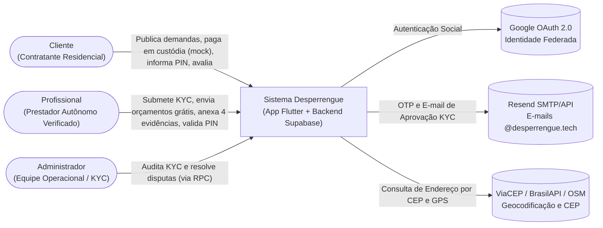
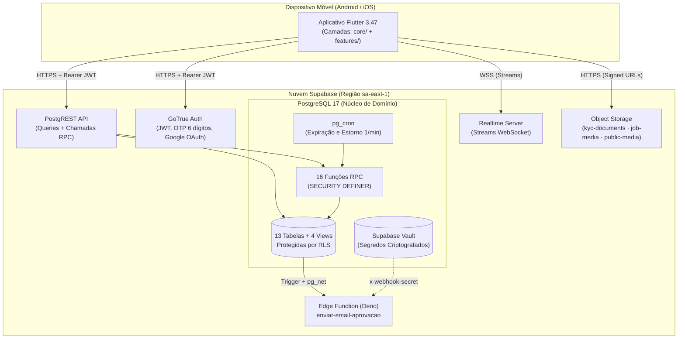
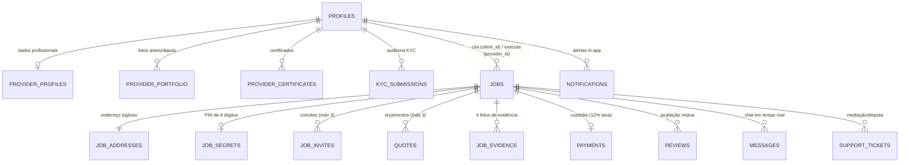

# Arquitetura do Sistema — Desperrengue

> **Escopo:** Este documento apresenta o planejamento e a implementação da arquitetura de software do aplicativo **Desperrengue** para a entrega da Etapa 3, detalhando a stack tecnológica (Frontend, Backend, Banco de Dados e Integrações), os diagramas arquiteturais (Modelo C4), o esquema relacional, as máquinas de estado e os controles de segurança.
> **Referência Técnica Completa:** Para detalhes adicionais de baixo nível e matrizes STRIDE, consulte também o documento técnico vivo [`ARCHITECTURE.md`](ARCHITECTURE.md) e os 12 Registros de Decisão de Arquitetura em [`docs/adr/`](./adr/README.md).

---

## 1. Planejamento e Justificativa da Stack Tecnológica

A arquitetura do **Desperrengue** segue o estilo **Cliente–Servidor em Duas Camadas Lógicas apoiado em BaaS (*Backend-as-a-Service*)**, adotando o paradigma de **"Banco de Dados como Núcleo de Domínio" (*Database-Centric Architecture*)** ([ADR-0001](./adr/0001-baas-supabase-como-backend.md) e [ADR-0003](./adr/0003-regras-de-negocio-no-banco-via-rpc.md)).

Nesse modelo, o aplicativo móvel é tratado sob a premissa de **Zero-Trust no Cliente**: toda validação na interface tem propósito meramente ergonômico (UX), enquanto todas as regras críticas de negócio — limite de 3 orçamentos, custódia financeira (*escrow*), sigilo de endereço/PIN, imutabilidade de notas e bloqueio de auto-aprovação de KYC — são impostas diretamente pelo motor do banco **PostgreSQL 17** via políticas **RLS (*Row Level Security*)**, *triggers* e funções **`SECURITY DEFINER`**.

### 1.1. Matriz da Stack Tecnológica Utilizada

| Camada | Tecnologia / Versão | Papel no Sistema | Justificativa Técnica e de Negócio |
| :--- | :--- | :--- | :--- |
| **Frontend Mobile** | **Flutter 3.47** (Dart $\ge$ 3.13.4) | Aplicativo nativo multiplataforma (Android e iOS) em base de código única (`app/`). | Alta performance gráfica (60/120 fps), tipagem estática forte, suporte a tematização dinâmica Material 3 (Modo Cliente Laranja / Modo Profissional Azul) e produtividade para equipe enxuta ([ADR-0002](./adr/0002-flutter-como-cliente-movel-unico.md)). |
| **Roteamento e Estado** | `Navigator` + `AuthGate` + `AppSession` (`ChangeNotifier`) | Guarda reativa de sessão, tratamento de *deep links* e função pura de roteamento `destinationFor()`. | Desacopla a lógica de redirecionamento pós-login da árvore de widgets, permitindo cobertura de testes unitários em Dart puro sem dependências nativas ([ADR-0009](./adr/0009-roteamento-por-funcao-pura-e-authgate.md)). *Nota: a migração para `go_router` + `Riverpod` amplo está planejada no Épico E-16 do Roadmap.* |
| **Banco de Dados** | **PostgreSQL 17** (Supabase `sa-east-1` — São Paulo) | Persistência relacional, integridade transacional, RLS, *views* de privacidade e RPCs em PL/pgSQL. | Garante consistência ACID para operações financeiras (custódia, estornos e comissão de 12%), *advisory locks* contra condições de corrida e baixa latência no Brasil. |
| **API de Dados** | **PostgREST** (Supabase REST) | Exposição automática de tabelas, *views* e chamadas remotas de procedimentos (RPC) sobre HTTPS + JWT. | Elimina a necessidade de manter um servidor intermediário boilerplate em Node/Java, reduzindo o custo operacional no cenário Lean (MVP). |
| **Autenticação** | **Supabase Auth (GoTrue)** | Cadastro com e-mail/senha + código **OTP de 6 dígitos** e login federado **Google OAuth 2.0**. | Emissão segura de tokens JWT assinados que alimentam diretamente `auth.uid()` nas políticas RLS do PostgreSQL. |
| **Tempo Real** | **Supabase Realtime** (WebSockets sobre WAL) | Atualização instantânea de `jobs`, `quotes`, `job_invites`, `messages` (chat) e `notifications`. | Permite que a tela do cliente e do profissional reajam ao vivo quando um orçamento chega, um convite de emergência é aceito ou o PIN é validado. |
| **Armazenamento** | **Supabase Storage** (S3-compatível) | Buckets privados (`kyc-documents`, `job-media`) e público (`public-media`). | Isola documentos sensíveis (RG/CNH, selfie, fotos da residência) com leitura restrita a URLs assinadas temporárias (*Signed URLs*). |
| **Backend Serverless** | **Supabase Edge Functions** (Deno / TypeScript) | Função `enviar-email-aprovacao` acionada via webhook `pg_net` autenticado por segredo no **Vault**. | Executa integrações externas que exigem chaves secretas (`service_role` e API do Resend) fora do alcance do cliente ([ADR-0010](./adr/0010-webhook-autenticado-por-segredo-no-vault.md)). |
| **Agendamento (Jobs)** | **`pg_cron`** (no PostgreSQL) | Rotinas periódicas a cada 1 minuto (`expire-invites` e `kyc-mock-approval`). | Cancela convites expirados (2h agendado / 5 min emergência) e **estorna automaticamente** reservas financeiras sem depender de intervenção manual. |
| **Integrações Externas** | **Resend** (E-mail), **ViaCEP / BrasilAPI** (CEP) e **Nominatim OSM** (GPS) | Envio de e-mails transacionais (`@desperrengue.tech`) e preenchimento automático de endereço. | APIs gratuitas ou de baixo custo que reduzem o atrito de preenchimento no cadastro e garantem entregabilidade DKIM/SPF. |

---

## 2. Visão Arquitetural em Camadas (Modelo C4)

### 2.1. Diagrama de Contexto (C4 — Nível 1)



### 2.2. Diagrama de Contêineres (C4 — Nível 2)



---

## 3. Arquitetura Interna do Aplicativo Flutter (`app/lib/`)

O código do aplicativo móvel está organizado sob separação estrita de responsabilidades:

```text
app/lib/
├── main.dart                         # Inicialização do Supabase, localização pt_BR e tema reativo
├── core/                             # Camada de infraestrutura e domínio (independente de telas)
│   ├── constants/env.dart            # Variáveis injetadas via --dart-define
│   ├── models/                       # Modelos puros em Dart (UserProfile, Job, Quote, Payment...)
│   ├── services/                     # ÚNICA camada que conhece tabelas, views e RPCs do Supabase
│   ├── ui/                           # Design System (AppColors, AppTheme, widgets reutilizáveis)
│   └── utils/                        # Formatadores pt-BR (moeda, datas, distância) e CEP/GPS
└── features/                         # Módulos funcionais de interface (UI)
    ├── auth/                         # Login, Cadastro, OTP, Seleção de Modo, KYC (Etapas 1–7), AuthGate
    ├── client/                       # Home, Busca, Perfil Público, Wizard de Pedido, Custódia, Avaliação
    ├── provider/                     # Painel, Oportunidades, Orçamento (12%), Execução, Evidências, PIN, Carteira
    └── shared/                       # Chat em tempo real, Central de Notificações e Suporte/Disputa
```

**Invariantes Arquiteturais do Frontend:**
1. `core/*` **nunca** importa arquivos de `features/*`.
2. Nenhum widget em `features/*` realiza queries diretas ao Supabase; toda comunicação passa exclusivamente por `core/services/*` (`ProfileService`, `JobService`, `ProviderService`, `SocialService`, `MediaService`).
3. Os modelos em `core/models/*` são classes Dart puras, permitindo que a suíte de **36 testes unitários** (`flutter test`) valide o roteamento multi-modo, o cálculo financeiro e os parsers de CEP/GPS em milissegundos.

---

## 4. Modelo de Dados Relacional (`supabase/migrations/`)

O esquema do banco é versionado através de **9 migrations sequenciais** em [`supabase/migrations/`](../supabase/migrations).



### Principais Tabelas e Políticas de Privacidade ([ADR-0007](./adr/0007-privacidade-por-minimizacao-de-dados.md))

| Tabela / View | Descrição e Regra de Segurança (RLS) |
| :--- | :--- |
| **`profiles`** | Perfil unificado do usuário (`is_client`, `is_provider`, `verification_status`). Colunas sensíveis são protegidas contra `UPDATE` direto pelo cliente via *trigger* `profiles_protect_columns`. |
| **`provider_profiles`** | Bio, especialidades, taxa de visita, valor/hora, raio de atendimento e métricas agregadas (`rating_avg`, `jobs_done` — alteráveis apenas por *trigger* do servidor). |
| **`jobs` e `job_addresses`** | Para proteger a segurança residencial do cliente, a tabela `jobs` contém apenas bairro/cidade e coordenadas aproximadas. O logradouro, número e complemento ficam isolados em **`job_addresses`**, cuja política RLS só permite leitura ao cliente dono e ao **profissional efetivamente contratado** (`provider_id`). |
| **`job_secrets`** | Armazena o **PIN de 4 dígitos** gerado no momento do pagamento em custódia. A RLS permite leitura **exclusivamente ao cliente dono**. O profissional nunca lê essa tabela; ele submete o código à RPC `complete_job_with_pin`, que valida o valor no servidor e persiste o contador de tentativas (`pin_attempts`, bloqueando após 5 falhas). |
| **`quotes`** | Propostas enviadas pelos profissionais. Um *trigger* com *advisory lock* garante que uma demanda receba no máximo **3 orçamentos ativos** (RF-04) e que cada prestador veja apenas a sua própria proposta (RNF-04). |
| **`payments`** | Registro financeiro da custódia (*escrow*). Calcula no servidor o valor total (`amount`), a **comissão de 12% da plataforma (`fee_amount`)** e o valor líquido de 88% do profissional (`net_amount`). |

---

## 5. Ciclo de Vida do Pedido e Regras de Negócio em RPCs

Toda transição de estado crítica ocorre dentro de transações atômicas via **16 funções RPC (`SECURITY DEFINER`)**:

1. **Criação e Convite (`invite_providers`):** O cliente publica a demanda (`status = 'open'`) e pode convidar até 3 profissionais (janela de resposta de 2 horas).
2. **Orçamento (`quotes`):** Apenas profissionais com `verification_status = 'ACTIVE'` podem enviar orçamento (RF-07) e **não podem orçar no próprio pedido** (`self_service_guards`).
3. **Aceite (`accept_quote`):** Trava a linha do pedido (`SELECT ... FOR UPDATE`), marca a proposta escolhida como `accepted`, rejeita automaticamente as demais e move o chamado para `awaiting_payment`.
4. **Pagamento em Custódia (`pay_job_mock` / `request_emergency_mock`):** Registra o depósito simulado (`payments.status = 'escrow'`), gera o PIN aleatório de 4 dígitos em `job_secrets` e inicia a execução (`jobs.status = 'in_progress'`).
5. **Conclusão Presencial (`complete_job_with_pin`):** Exige que o profissional contratado informe o PIN do cliente. Quando válido, o pedido vai para `completed`, o pagamento muda de `escrow` para `released` e o contador `jobs_done` do profissional é incrementado.
6. **Mediação e Estorno (`create_support_ticket` / `cancel_job` / `expire_invites`):** Se houver disputa, o chamado vai para `disputed` e congela o repasse até decisão administrativa (`admin_resolve_dispute`). Em emergências não respondidas em 5 minutos, o `pg_cron` cancela o pedido e estorna o pagamento (`refunded`).

---

## 6. Hospedagem, Implantação, CI/CD e Verificação de Qualidade

* **Infraestrutura em Nuvem:** Hospedada na região Sul-Americana da AWS (`sa-east-1`, São Paulo) através da plataforma gerenciada **Supabase** (projeto `eisfkemgooqbgqljvwvs`), com domínio transacional próprio **`desperrengue.tech`** autenticado no **Resend** (registros DNS DKIM, SPF e DMARC ativos — ver [`docs/registro_dominio_resend.md`](./registro_dominio_resend.md)).
* **Integração Contínua (GitHub Actions):** O workflow [`.github/workflows/ci.yml`](../.github/workflows/ci.yml) é executado em cada *Push* e *Pull Request*, validando:
  * Análise estática rigorosa (`flutter analyze` com zero avisos);
  * Execução da suíte de **36 testes unitários** em Dart (`flutter test`).
* **Verificação Automatizada de Segurança no Banco (`security_smoke.sql`):**
  * O script [`supabase/tests/security_smoke.sql`](../supabase/tests/security_smoke.sql) executa **62 asserções SQL transacionais** diretamente contra o banco PostgreSQL, testando tentativas de invasão (auto-aprovação de KYC, leitura de endereço/PIN por terceiros, burla do limite de 3 orçamentos, força bruta no PIN e acesso anônimo), exigindo resultado `FALHAS = 0`.
* **Empacotamento Android (Play Store):** Configurado em `app/android/` com assinatura de release e guia de publicação em trilha de teste interno documentado em [`docs/PLAY_STORE.md`](./PLAY_STORE.md).
