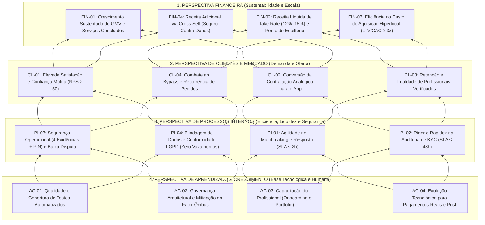

# Balanced Scorecard (BSC) — Desperrengue

> **Escopo:** Este documento apresenta o planejamento estratégico da startup **Desperrengue** estruturado na metodologia **Balanced Scorecard (BSC)** de Kaplan e Norton. Contempla **4 objetivos estratégicos para cada uma das 4 perspectivas** (totalizando 16 objetivos, acima do mínimo exigido de 3 por perspectiva), totalmente alinhados à Missão, Visão e Valores do [Documento de Contexto](./Documento%20de%20Contexto.md), às premissas do [Plano de Negócio e Tributação](./Planos%20de%20Negocio%20e%20Tributação.md) e às métricas *North Star* e épicos do [ROADMAP](ROADMAP.md).
> **Arquivo de Planilha:** Uma versão tabular em formato CSV pronta para abertura no Microsoft Excel ou Google Sheets encontra-se em [`docs/planilhas/bsc_desperrengue.csv`](./planilhas/bsc_desperrengue.csv).

---

## 1. Alinhamento com os Norteadores Estratégicos

* 🎯 **Missão:** Democratizar e garantir segurança no acesso a serviços residenciais, valorizando o profissional autônomo através de relações comerciais mais justas e transparentes.
* 🔭 **Visão:** Ser o principal aplicativo de serviços domésticos do país, reconhecido por erradicar o pagamento injusto por leads e por ser o sinônimo de confiança para as famílias.
* ⭐ **Valores:** **Justiça** (zero cobrança por orçamento), **Confiança** (KYC rigoroso, custódia e PIN) e **Simplicidade** (UX fluida em Flutter + Supabase).
* 🌟 **Métrica *North Star*:** Número de **Serviços Concluídos e Pagos por Semana** (`jobs.status = 'completed'`).

---

## 2. Mapa Estratégico do BSC (Relações de Causa e Efeito)

O diagrama abaixo demonstra como o fortalecimento da base (**Aprendizado e Crescimento**) viabiliza a excelência operacional e de segurança (**Processos Internos**), que gera confiança e retenção nas duas pontas do marketplace (**Clientes e Profissionais**), resultando na sustentabilidade econômica (**Financeira**):

---

## 3. Planilha Completa do Balanced Scorecard (BSC)

### 3.1. Perspectiva Financeira
*Foco: Garantir a viabilidade financeira do modelo de comissionamento por sucesso (Take Rate), controle de custos enxutos (Lean) e alcance do Ponto de Equilíbrio (Break-even).*

| ID | Objetivo Estratégico | Indicador (KPI) | Meta (Ano 1) | Prazo | Iniciativas Estratégicas / Plano de Ação |
| :--- | :--- | :--- | :--- | :--- | :--- |
| **FIN-01** | Expandir o Volume Bruto Transacionado (**GMV**) através de serviços concluídos | GMV Mensal ($\sum \text{payments.amount}$ com `status = 'released'`) e Nº de Serviços Concluídos/mês | Atingir **R$ 45.000/mês de GMV** (≈ 250 serviços/mês a ticket médio de R$ 180) até o Mês 12 | Mês 1 ao Mês 12 | Lançamento hiperlocal focado nas categorias de maior demanda da pesquisa: Limpeza (57,1%) e Reparos/Reformas (39,3%). |
| **FIN-02** | Garantir a sustentabilidade operacional e atingir o **Break-even** (Ponto de Equilíbrio) | Receita Líquida de Comissão (*Take Rate* de **12%**, deduzidos 6% do Simples Nacional e taxa de gateway) vs. Custos Fixos | **Fluxo de Caixa Operacional Positivo** a partir do **Mês 4** (Cenário Lean) e margem operacional $\ge 25\%$ no Mês 12 | Mês 4 (Break-even Lean) | Operar no Cenário Lean (custo fixo ~R$ 530/mês) durante a validação e aplicar *split* automático no Simples Nacional (CNAE `7490-1/04`). |
| **FIN-03** | Manter alta eficiência no Custo de Aquisição de Clientes e Profissionais (**CAC**) | Relação **LTV / CAC** e CAC médio por usuário ativo | **CAC $\le$ R$ 25,00** por cliente convertido e razão **LTV/CAC $\ge 3,0$** | Contínuo (Revisão Trimestral) | Priorizar parcerias orgânicas com síndicos de condomínios, indicações locais e anúncios geolocalizados por raio de bairro (Google Ads R$ 300/mês inicial). |
| **FIN-04** | Desenvolver nova linha de receita de alta margem via **Cross-Sell de Proteção** | Taxa de adesão (*Attach Rate*) ao **Seguro/Garantia Contra Danos** no checkout | $\ge$ **30% dos pedidos** contratando a taxa extra de garantia até o final do 1º ano de operação comercial | 2º Semestre de Operação | Implementar opção de garantia estendida no checkout (validada por **92,9%** dos clientes na pesquisa de mercado). |

---

### 3.2. Perspectiva de Clientes e Mercado (Demanda e Oferta)
*Foco: Eliminar o medo de contratar desconhecidos (lado Cliente) e erradicar a frustração de pagar por orçamentos perdidos (lado Profissional).*

| ID | Objetivo Estratégico | Indicador (KPI) | Meta (Ano 1) | Prazo | Iniciativas Estratégicas / Plano de Ação |
| :--- | :--- | :--- | :--- | :--- | :--- |
| **CL-01** | Consolidar a percepção de **Segurança e Confiança** nas duas pontas do marketplace | **NPS (*Net Promoter Score*)** pós-serviço e Nota Média Geral (`rating_avg`) | **NPS $\ge 50$** (Zona de Qualidade) e avaliação média nas estrelas **$\ge 4,7 / 5,0$** | Contínuo (Desde o MVP) | Exigir verificação KYC completa, exibir selo de *Profissional Verificado* e manter avaliação mútua obrigatória pós-PIN (`submit_review`). |
| **CL-02** | Converter clientes do mercado informal ("boca a boca" e WhatsApp) para contratações no app | **Taxa de Conversão de Pedidos** (`jobs completed / jobs criados`) | **$\ge 25\%$** dos pedidos publicados convertidos em serviços pagos e concluídos | Mês 1 ao Mês 6 | Limitar a disputa a no máximo **3 orçamentos gratuitos** para evitar paralisia de escolha e destacar o banner de *Custódia Protegida*. |
| **CL-03** | Atrair e reter profissionais qualificados através do modelo justo (*Success Fee*) | **Taxa de Retenção Mensal da Oferta** (prestadores ativos que enviam $\ge 1$ orçamento/mês) e Taxa de Resposta a Convites | **$\ge 80\%$ de retenção** trimestral de profissionais aprovados e **$\ge 60\%$ de resposta** a convites diretos | Mês 1 ao Mês 12 | Manter custo zero para envio de orçamentos, transparência da comissão de 12% na tela de proposta e repasse imediato à carteira após validação do PIN. |
| **CL-04** | Aumentar a recorrência de contratação e mitigar a desintermediação (*Bypass*) | **Taxa de Recompra** (clientes com $\ge 2$ pedidos concluídos no semestre) | **$\ge 35\%$ de clientes recorrentes** em até 90 dias após o 1º serviço | Mês 3 ao Mês 12 | Atrelar benefícios exclusivos à transação dentro do app: fotos automáticas no Portfólio Verificado do profissional, custódia financeira e cupons de retorno. |

---

### 3.3. Perspectiva de Processos Internos
*Foco: Garantir liquidez rápida de orçamentos, triagem documental rigorosa, proteção antifraude em campo e conformidade absoluta de privacidade.*

| ID | Objetivo Estratégico | Indicador (KPI) | Meta (Ano 1) | Prazo | Iniciativas Estratégicas / Plano de Ação |
| :--- | :--- | :--- | :--- | :--- | :--- |
| **PI-01** | Assegurar rapidez de resposta nos pedidos agendados e de emergência | **Tempo Mediano até o 1º Orçamento** ($\min(\text{quotes.created\_at}) - \text{jobs.created\_at}$) e tempo de aceite em Emergência | **$\le 2\text{ horas}$** para pedidos agendados e **$\le 5\text{ minutos}$** no Radar de Emergência | Contínuo | Notificações em tempo real (*Supabase Realtime*), opção de convidar até 3 profissionais simultaneamente e rotina `pg_cron` (`expire-invites`) a cada 1 min. |
| **PI-02** | Garantir triagem rigorosa e ágil no Onboarding de Profissionais (**KYC**) | **SLA de Revisão Documental** (tempo entre `submit_kyc` e decisão administrativa) | **100% dos cadastros auditados em $\le 48\text{ horas}$** e **0%** de profissionais não verificados orçando | Até Entrega do MVP / Épico E-07 | Fluxo guiado de 7 etapas (RG frente/verso, selfie ao vivo, registro CREA/CFT/CNPJ), bloqueio por RLS e envio automático de e-mail via Edge Function + Resend. |
| **PI-03** | Minimizar falhas de execução, calotes e litígios através de evidências e PIN | **Índice de Disputas** (`support_tickets / jobs completed × 100`) e SLA de Mediação | **$\le 3\%$ de chamados com disputa** e **100% dos tickets respondidos em $\le 24\text{h}$** | Contínuo | Obrigatoriedade das **4 fotos de evidência** antes da conclusão, validação do **PIN de 4 dígitos** (trava em 5 erros) e congelamento automático do *escrow* em disputas. |
| **PI-04** | Assegurar privacidade por minimização de dados e blindagem contra fraudes de API | Nº de incidentes de vazamento de endereço/PIN/KYC e falhas no *Smoke Test* de segurança | **Zero (0) falhas** nas **62 asserções** do `security_smoke.sql` e **Zero (0)** exposições indevidas | Contínuo (Em cada Migration) | Isolamento de endereço completo em `job_addresses` e PIN em `job_secrets` ([ADR-0007](./adr/0007-privacidade-por-minimizacao-de-dados.md)), buckets privados com URLs assinadas e proteção de colunas por *trigger*. |

---

### 3.4. Perspectiva de Aprendizado, Crescimento e Tecnologia
*Foco: Sustentação da qualidade de engenharia de software, redução de dívida técnica, automação de testes e capacitação da base de prestadores.*

| ID | Objetivo Estratégico | Indicador (KPI) | Meta (Ano 1) | Prazo | Iniciativas Estratégicas / Plano de Ação |
| :--- | :--- | :--- | :--- | :--- | :--- |
| **AC-01** | Elevar a cobertura de testes automatizados no Frontend e Backend | Cobertura de código (`flutter test --coverage`), avisos estáticos (`flutter analyze`) e testes SQL | **$\ge 60\%$ de cobertura em `core/`**, **$\ge 40\%$ global**, **0 avisos** no `analyze` e **62/62 checks SQL** verdes | Dezembro/2026 (Épico E-06) | Manter pipeline CI no GitHub Actions (`ci.yml`), ampliar testes unitários (atualmente 36 testes) e implementar *widget tests* para telas críticas. |
| **AC-02** | Mitigar o risco de dependência individual (*Fator Ônibus = 1*) via governança documental | Índice de atualização da documentação técnica (ADRs, `ARCHITECTURE.md`, `CHANGELOG.md`, `SETUP.md`) | **100% das decisões arquiteturais** registradas em ADRs e guias de setup funcionais (Windows, Linux e macOS) | Concluído na Etapa 3 e Contínuo | Manter os 10 ADRs atualizados, padronizar commits semânticos (*Conventional Commits*) e exigir revisão via *Pull Request* conforme `CONTRIBUTING.md`. |
| **AC-03** | Educar e qualificar os prestadores autônomos nas boas práticas de atendimento digital | Taxa de conclusão do **Setup Pós-KYC** (portfólio preenchido + certificados enviados) | **$\ge 75\%$ dos profissionais ativos** com bio, especialidades e pelo menos 1 trabalho no portfólio Antes/Depois | Mês 1 ao Mês 6 | Telas educativas integradas no onboarding (`06a` Como funciona, `06b` Dicas de bom perfil) e conversão automática das 4 fotos de evidência em itens de portfólio. |
| **AC-04** | Evoluir a infraestrutura do MVP acadêmico para operação comercial escalável | Conclusão dos Épicos de Produção do Roadmap (**E-08 Staging**, **E-13 Pagamentos Reais** e **E-15 Push**) | **100% dos épicos críticos de produção** implantados antes do lançamento comercial aberto | 1º Semestre de 2027 | Separar ambientes Supabase (*Staging* vs. *Prod*), substituir *mock* financeiro por gateway real com *split* Pix/Cartão e ativar notificações via FCM/APNs. |
