# Projeto de Interface (UI/UX) — Desperrengue

> **Escopo:** Este documento apresenta o projeto de interface do usuário (UI) e experiência do usuário (UX) do aplicativo móvel **Desperrengue**, detalhando o fluxo de telas (*User Flow*), a arquitetura de navegação multi-modo, os protótipos de alta fidelidade (*Hi-Fi*) e o mapeamento direto com as telas já implementadas em **Flutter** (`app/lib/features/`).
> **Documentos correlatos:** [Template Padrão e Design System](./Template.md) · [Especificação do Projeto](./Especificação%20do%20Projeto.md) · [Arquitetura do Sistema](./Arquitetura%20do%20Sistema.md) · Fichas analíticas de telas em [`docs/specs/`](./specs).

---

## 1. Visão Geral e Princípios de Interação Humano-Computador (IHC)

O projeto de interface do **Desperrengue** foi concebido para atacar a dor central validada na pesquisa de mercado do projeto (N = 46 respondentes): **a assimetria de confiança** entre clientes (60,7% relatam medo de colocar um desconhecido em casa) e profissionais (100% rejeitam pagar por orçamentos sem garantia de fechamento).

Para responder a esse desafio, o design de interação adota cinco diretrizes fundamentais baseadas nas Heurísticas de Nielsen:

1. **Identidade Visual Contextual por Modo (Prevenção de Erros e Visibilidade de Estado):** Uma mesma conta pode atuar como **Cliente** e como **Profissional** ([ADR-0005](./adr/0005-modelo-multi-modo-por-flags.md)). Para que o usuário saiba imediatamente em qual papel está operando, toda a interface muda de cor semântica: **Laranja (`#F26B0F`)** no modo Cliente e **Azul (`#1B3A78`)** no modo Profissional.
2. **Redução de Carga Cognitiva (Wizards Passo a Passo):** Tarefas complexas foram divididas em micro-interações guiadas por barras de progresso (*steppers*), como o **Assistente de Pedido em 3 passos** (Cliente) e o **Onboarding de Verificação KYC em 7 etapas** (Profissional).
3. **Transparência Financeira e de Segurança (*Affordances* de Confiança):** Em todos os pontos críticos (aceite de orçamento, checkout em custódia e execução), banners semânticos em tom *Teal/Segurança* (`#2A7F86`) e *Verde/Sucesso* (`#2FB67C`) explicam que o valor fica retido em custódia (*Escrow*) e só é liberado mediante o **PIN de confirmação de 4 dígitos** e **4 fotos obrigatórias de evidência**.
4. **Tolerância a Falhas e Recuperação de Rascunho (`DraftStore`):** Formulários extensos (cadastro de endereço com preenchimento automático via ViaCEP/GPS e submissão de KYC) preservam rascunhos locais automaticamente caso o usuário feche o aplicativo.
5. **Reatividade em Tempo Real:** As telas de acompanhamento de chamado (`ClientJobScreen` e `ProviderJobScreen`) escutam eventos via *Supabase Realtime* (`.stream()`), atualizando cronômetros, contadores de propostas (máx. 3) e status do serviço sem necessidade de recarregamento manual.

---

## 2. Diagrama de Fluxo de Telas (*User Flow*)

O fluxo abaixo reflete fielmente a função pura de roteamento `destinationFor(profile, mode, forceSelection)` implementada em `app/lib/core/models/user_profile.dart` e orquestrada pelo `AuthGate` / `PostAuthRouter` ([ADR-0009](./adr/0009-roteamento-por-funcao-pura-e-authgate.md)).

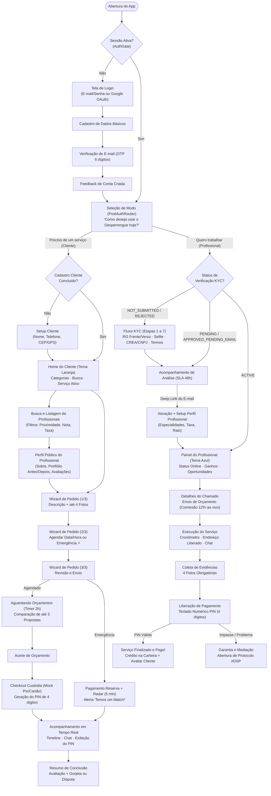

---

## 3. Catálogo de Interfaces (Protótipos Hi-Fi vs. Implementação Flutter)

Todos os protótipos de alta fidelidade estão versionados em `docs/ui_ux/hi-fi_prototyping/` e possuem especificações detalhadas em `docs/specs/`. Abaixo apresenta-se a síntese de cada módulo e sua rastreabilidade com os Requisitos Funcionais (RF) e o código-fonte.

### 3.1. Módulo 1: Autenticação, Cadastro OTP e Seleção de Modo

Responsável pela gestão de identidade (RF-01) e pela escolha do modo de operação da sessão (`UserMode.client` ou `UserMode.provider`).

| Tela / Etapa | Protótipo Hi-Fi (`docs/ui_ux/hi-fi_prototyping/`) | Implementação Flutter (`app/lib/features/auth/presentation/`) | Descrição Funcional |
| :--- | :--- | :--- | :--- |
| **Login de Acesso** | `1_autenticcao_e_roteamento/00_login_acesso.jpg` | `login_screen.dart` | Autenticação por e-mail/senha ou OAuth 2.0 (Google). |
| **Cadastro Básico** | `1_autenticcao_e_roteamento/01_cadastro_dados_basicos.jpg` | `cadastro_dados_basicos.dart` | Coleta de nome, e-mail, senha forte e aceite dos Termos de Uso. |
| **Verificação OTP** | `1_autenticcao_e_roteamento/02_cadastro_verificacao_otp.jpg` | `cadastro_verificacao_otp.dart` | Validação do código numérico de 6 dígitos enviado via SMTP/Resend. |
| **Confirmação de Conta** | `1_autenticcao_e_roteamento/03_cadastro_sucesso_routing.jpg` | `cadastro_sucesso_routing.dart` | Feedback visual de identidade criada e redirecionamento automático. |
| **Seleção de Modo** | `1_autenticcao_e_roteamento/01_b_selecao_de_sessao.jpg` | `role_selection_screen.dart` | Tela-chave multi-modo: exibe cartões *"Preciso de um serviço"* (Cliente) e *"Quero trabalhar"* (Profissional), indicando o estado atual do cadastro em cada modo. |

```carousel

<!-- slide -->

<!-- slide -->

<!-- slide -->

```

---

### 3.2. Módulo 2: Onboarding e Verificação Documental do Profissional (KYC)

Implementa os requisitos **RF-06** e **RF-07** (detalhados em [`docs/onboarding_profissional.md`](./onboarding_profissional.md)). Nenhum prestador pode enviar orçamentos ou aparecer na busca pública até que seu status atinja `ACTIVE`.

| Etapa | Protótipo Hi-Fi (`1_Telas_de_verificacao_profissional/`) | Implementação Flutter (`app/lib/features/auth/presentation/`) | Regra de Usabilidade e Segurança |
| :--- | :--- | :--- | :--- |
| **1. Frente do Documento** | `1_verificacao_frente_documento.jpg` | `verificacao_step1_frente.dart` | Upload para bucket privado `kyc-documents/{uid}/` via câmera ou galeria. |
| **2. Verso do Documento** | `2_verificacao_verso_documento.jpg` | `verificacao_step2_verso.dart` | Guia visual de enquadramento do documento civil (RG/CNH). |
| **3. Selfie Biométrica** | `3_verificacao_selfie.jpg` | `verificacao_step3_selfie.dart` | Restrição de input apenas para câmera ao vivo (*liveness*), prevenindo envio de fotos antigas da galeria. |
| **4. Registro Profissional** | `4_verificacao_registro_profissional.jpg` | `verificacao_step4_registro.dart` | Seleção de órgão (CREA, CFT, CNPJ/MEI) com salvamento automático em rascunho (`DraftStore`). |
| **5. Revisão e Envio** | `5_verificacao_finalizacao_envio.jpg` | `verificacao_step5_finalizacao.dart` | Submissão atômica via RPC `submit_kyc`, alterando status para `PENDING`. |
| **6. Orientações e Termos** | `06a_como_funciona_plataforma.png` a `06c_termos_prestacao_servicos.png` | `verificacao_step6a_como_funciona.dart`, `verificacao_step6b_dicas.dart`, `verificacao_step6c_termos.dart`, `verificacao_step6_feedback.dart` | Explicação da comissão justa (12% apenas no sucesso), dicas de perfil e acompanhamento do SLA de 48h. |
| **7. Aprovação e Ativação** | `07_parabens_aprovado_onboarding.png` | `verificacao_step7_aprovado.dart` | Acionada via *deep link* do e-mail de aprovação (`desperrengue://onboarding/ativar`), chamando a RPC `activate_provider`. |

```carousel
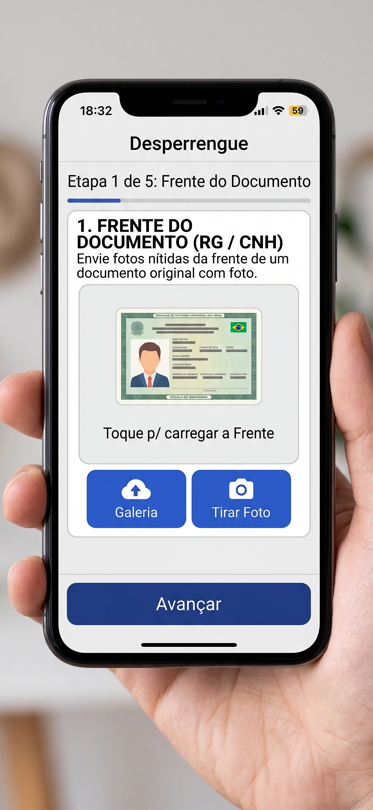
<!-- slide -->
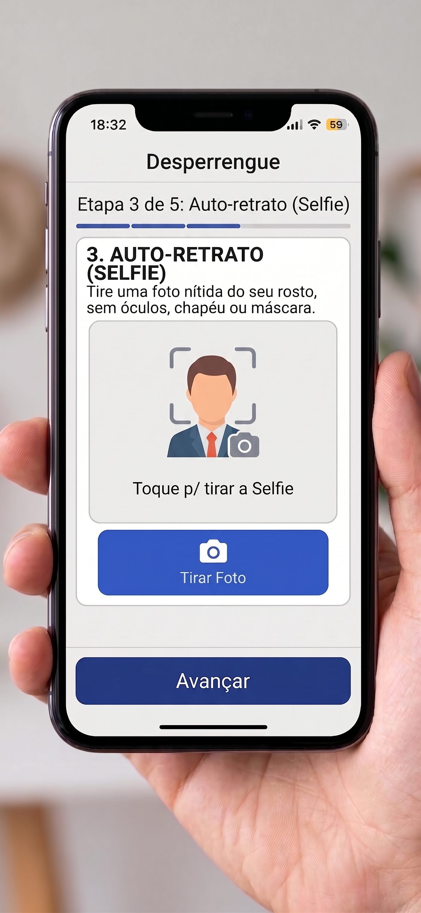
<!-- slide -->
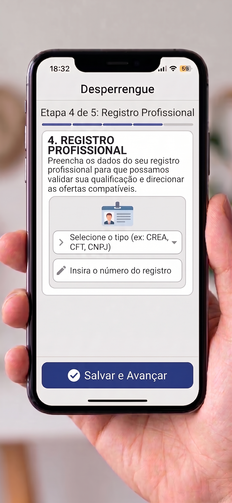
<!-- slide -->
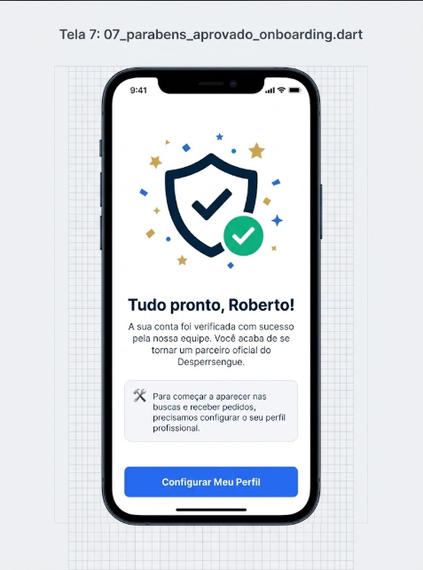
```

---

### 3.3. Módulo 3: Jornada Principal do Cliente (Descoberta, Pedido, Custódia e Avaliação)

Atende às histórias **US-01, US-02 e US-03** e aos requisitos **RF-02, RF-04 e RF-05** (especificação completa em [`docs/specs/cliente_telas.md`](./specs/cliente_telas.md)).

1. **Descoberta e Perfil Público (`1.jpg` a `5.jpg`):**
   * **Home do Cliente (`client_shell.dart` / `client_setup_screen.dart` / `address_form.dart`):** Saudação personalizada, seletor de endereço (preenchido via ViaCEP ou GPS), atalho para serviço em andamento, busca textual e grade de categorias (Elétrica, Hidráulica, Limpeza, Montagem, Pintura, Chaveiro).
   * **Busca e Perfil Público (`provider_search_screen.dart` / `provider_public_profile_screen.dart`):** Ordenação por proximidade, maior nota ou menor taxa de visita. Exibe selo de *Perfil Verificado*, estatísticas, carrossel de portfólio (Antes/Depois) e avaliações verificadas. Profissionais logados no modo cliente enxergam o próprio cartão com a etiqueta `"Você (Visão do cliente)"`, mas são bloqueados de contratar a si mesmos.
2. **Assistente de Pedido em 3 Passos (`6.jpg` a `8.jpg` — `request_wizard.dart`):**
   * **Passo 1 (O que precisa ser feito?):** Descrição textual (até 500 caracteres) e anexo de até 4 fotos do problema no bucket privado `job-media`.
   * **Passo 2 (Quando será o serviço?):** Alternância entre **📅 Agendar** (calendário mensal e grade de horários) ou **⚡ Para Agora** (fluxo de emergência com reserva prévia).
   * **Passo 3 (Revisão):** Resumo completo do chamado e envio para até 3 profissionais convidados ou abertura pública.
3. **Orçamentos, Checkout em Custódia e Acompanhamento (`9.jpg` a `16.jpg` — `client_job_screen.dart`, `payment_widgets.dart`, `order_tracking_screen.dart`, `completion_screens.dart`):**
   * **Espera e Comparação:** Anel regressivo de 2 horas para pedidos agendados (ou Radar de 5 minutos para emergências). O banco impõe o limite estrito de **no máximo 3 orçamentos** por demanda (RF-04).
   * **Aceite e Checkout Simulado (`pay_job_mock`):** Exibe transparência total do modelo *Escrow* (pagamento via Pix ou Cartão simulado). Ao confirmar o pagamento, o banco gera o **PIN secreto de 4 dígitos** na tabela protegida `job_secrets`.
   * **Execução, Conclusão e Avaliação:** O cliente acompanha a linha do tempo em tempo real, fornece o PIN presencialmente ao prestador somente após inspecionar o serviço e, em seguida, realiza a avaliação por estrelas, tags de elogio e gorjeta opcional (ou abre disputa com SLA de 24h).

```carousel
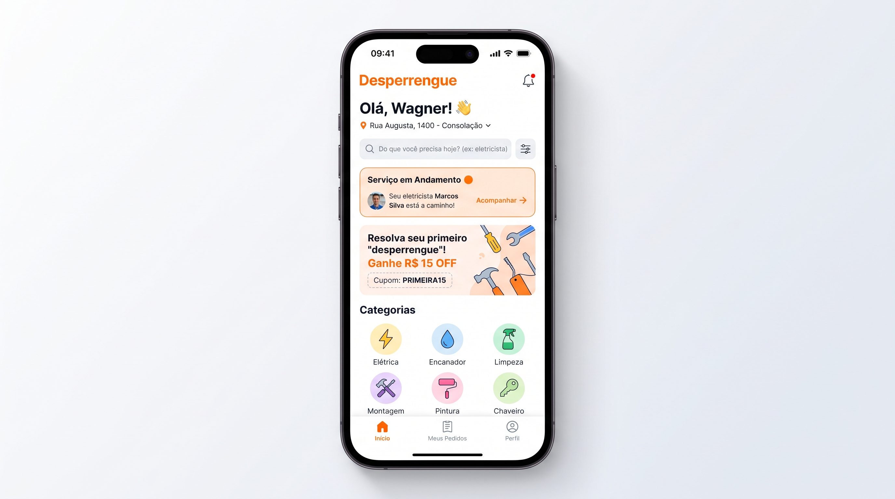
<!-- slide -->
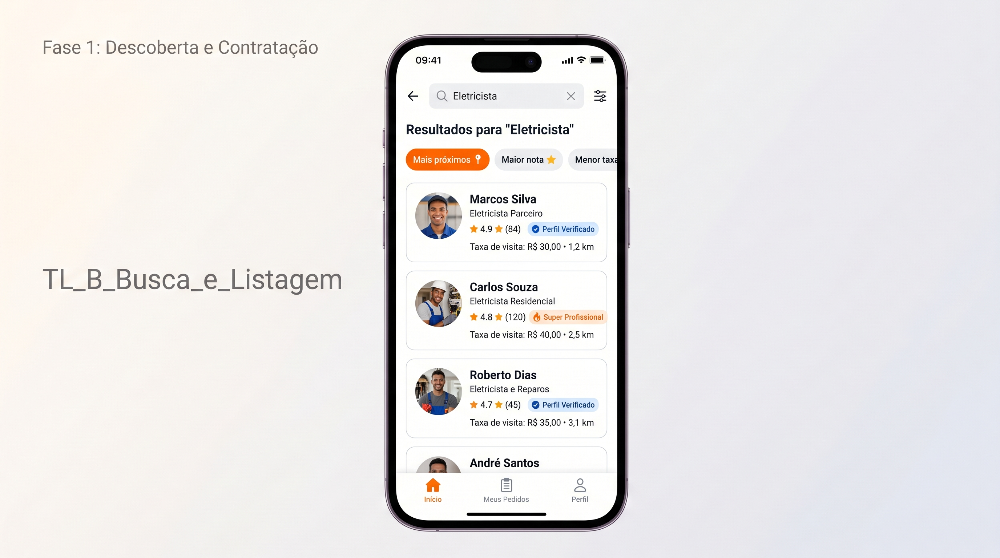
<!-- slide -->
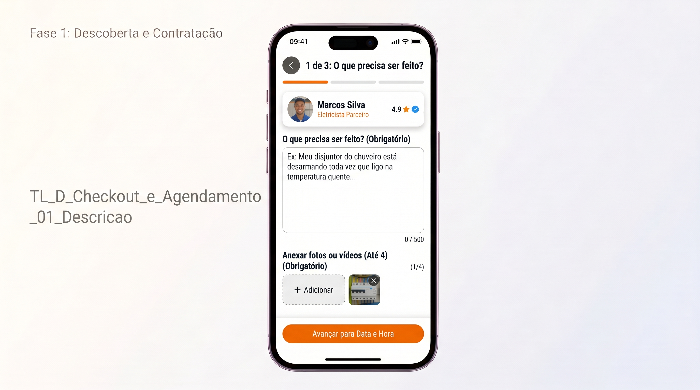
<!-- slide -->
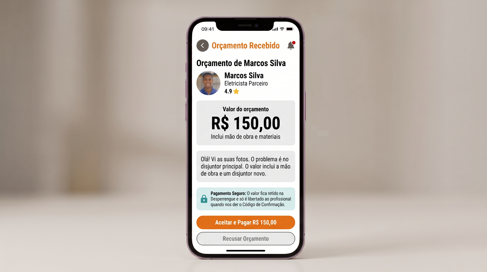
<!-- slide -->
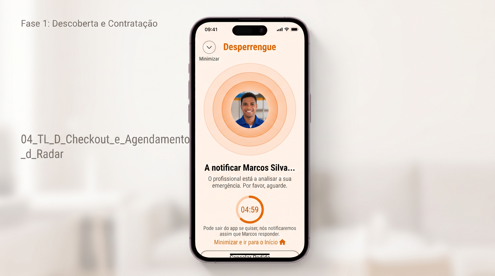
<!-- slide -->
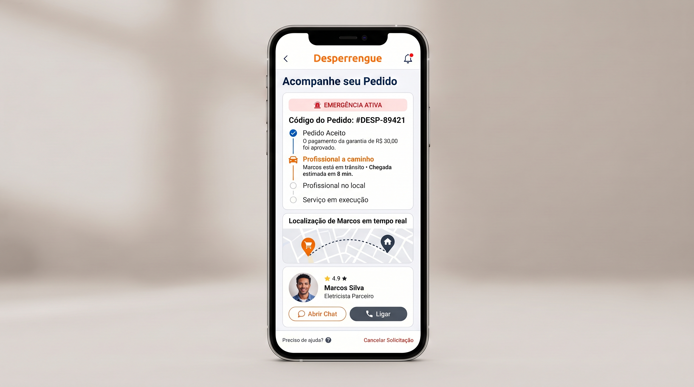
```

---

### 3.4. Módulo 4: Jornada Principal do Profissional (Oportunidades, Evidências, PIN e Carteira)

Atende às histórias **US-04 e US-05** e ao requisito **RF-03** (especificação completa em [`docs/specs/profissional_telas.md`](./specs/profissional_telas.md)).

1. **Painel, Oportunidades e Orçamento Transparente (`15.jpg` a `17.jpg` — `provider_shell.dart` / `provider_job_screen.dart`):**
   * Controle de disponibilidade (*Online/Offline*), resumo de ganhos, valor em custódia e lista de convites diretos ou demandas abertas na sua categoria.
   * Ao analisar uma solicitação, o profissional visualiza as fotos do problema (via URLs assinadas temporárias) e digita sua proposta financeira. A tela calcula **ao vivo a comissão de 12% da plataforma**, exibindo exatamente o valor líquido (88%) que cairá na sua carteira caso o serviço seja fechado — eliminando qualquer cobrança antecipada por orçamento.
2. **Execução, 4 Evidências Fotográficas e Liberação por PIN (`1.jpg` a `10.jpg` — `provider_execution_screens.dart`):**
   * **Execução (`1.jpg`):** Somente após o pagamento em custódia pelo cliente, a RLS do banco libera o **endereço completo** (`job_addresses`) para o profissional contratado ([ADR-0007](./adr/0007-privacidade-por-minimizacao-de-dados.md)). A tela exibe cronômetro ativo e confirmação de *Pagamento Retido e Garantido*.
   * **Checklist de 4 Evidências (`2.jpg` a `5.jpg`):** Para habilitar a finalização, o prestador registra 4 fotos obrigatórias (*Visão Geral*, *Detalhes da Peça*, *Outro Ângulo* e *Ambiente Limpo*), que servem tanto como prova técnica antifraude quanto para alimentar seu portfólio público.
   * **Teclado Numérico de PIN (`7.jpg` — RPC `complete_job_with_pin`):** O profissional digita o PIN de 4 dígitos informado pelo cliente. O banco persiste o contador de tentativas (bloqueando força bruta após 5 erros) e, se correto, transfere instantaneamente o saldo de `escrow` para `released`.
   * **Avaliação Bidirecional (`9.jpg`):** O profissional também avalia o cliente em 5 critérios (Simpatia, Educação, Recepção, Comunicação e Pontualidade).
3. **Carteira Digital, Gestão de Perfil e Mediação (`11.jpg` a `14.jpg` e `7_Gestao_de_Perfil_e_Gamificacao/`):**
   * **Carteira (`wallet_tab.dart`):** Exibe Saldo Disponível, Valor em Custódia, Próximos Lançamentos (incluindo valores retidos em mediação), gráfico de desempenho semanal e histórico dos últimos serviços realizados.
   * **Perfil, Portfólio e Cofre de Certificados (`provider_profile_screens.dart` / `provider_setup_screens.dart`):** Edição de bio, especialidades, taxa de visita, galeria de fotos Antes/Depois e envio de certificados técnicos.

```carousel
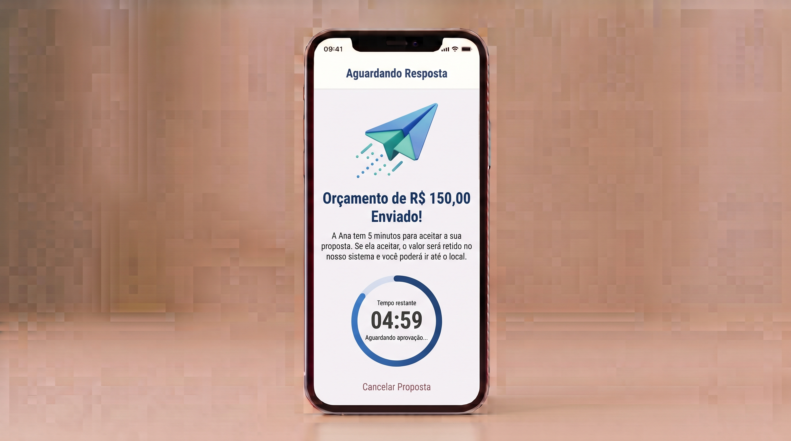
<!-- slide -->
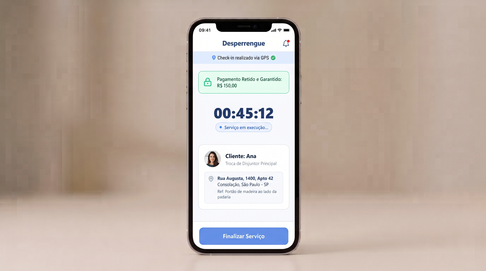
<!-- slide -->
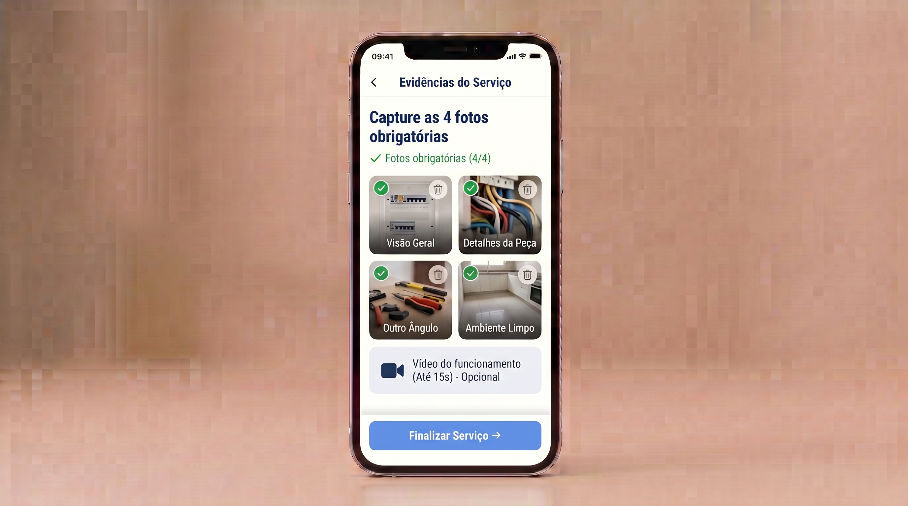
<!-- slide -->
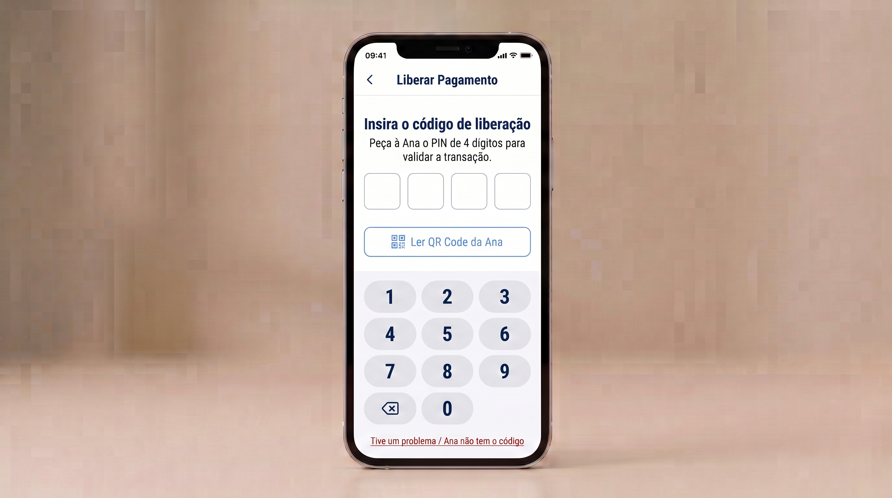
<!-- slide -->
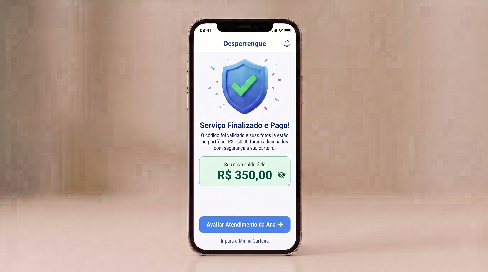
<!-- slide -->
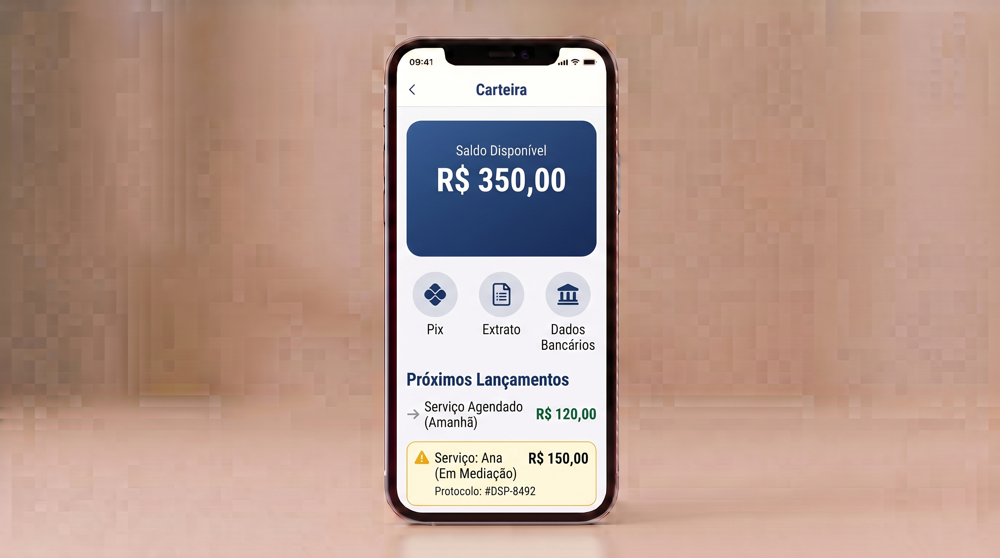
```

---

### 3.5. Módulo 5: Interfaces Compartilhadas (Chat em Tempo Real, Notificações e Mediação de Disputas)

Implementadas em `app/lib/features/shared/presentation/` e detalhadas em [`docs/specs/comum_telas.md`](./specs/comum_telas.md):

* **Chat Seguro por Demanda (`4_Telas_de_Chat_Pre_Servico/` — `chat_screen.dart`):** Canal de mensagens em tempo real (`messages` via *Supabase Realtime*), protegido por RLS para que apenas o cliente dono da demanda e os profissionais com vínculo ativo possam trocar mensagens e compartilhar localização.
* **Suporte e Mediação de Conflitos (`6_Suporte_e_Mediacao/` — `support_screens.dart` e `notifications_screen.dart`):** Caso ocorra divergência na execução ou recusa injustificada de fornecimento do PIN, qualquer uma das partes pode acionar o fluxo *"Tive um problema"*. O sistema congela a custódia (`jobs.status = 'disputed'`), permite anexar evidências fotográficas e gera um protocolo auditável (`#DSP-XXXX`) com SLA de análise de 24 horas pela equipe administrativa.

---

## 4. Matriz de Rastreabilidade: Requisitos $\leftrightarrow$ Interfaces $\leftrightarrow$ Código

| Requisito / História | Tela / Fluxo no Protótipo | Arquivo Implementado no App (`app/lib/features/`) |
| :--- | :--- | :--- |
| **RF-01** (Gestão de sessão e papéis) | Login, Cadastro OTP e Seleção de Sessão (`00_login` a `01_b_selecao`) | `auth/presentation/auth_gate.dart`, `auth/presentation/post_auth_router.dart`, `auth/presentation/role_selection_screen.dart` |
| **RF-02 / US-01** (Publicar demanda com fotos e categoria) | Home do Cliente e Wizard de Pedido 1/3 a 3/3 (`1.jpg`, `6.jpg` a `8.jpg`) | `client/presentation/client_shell.dart`, `client/presentation/request_wizard.dart` |
| **RF-03 / US-04 / US-05** (Receber demandas e orçar grátis) | Oportunidades e Envio de Orçamento com cálculo de 12% (`15.jpg` a `17.jpg`) | `provider/presentation/provider_shell.dart`, `provider/presentation/provider_job_screen.dart` |
| **RF-04 / US-02** (Limite de 3 orçamentos por demanda) | Aguardando Orçamento e Lista de 3 Propostas (`9.jpg`, `01_cliente_lista_orcamentos.jpg`) | `client/presentation/client_job_screen.dart` + Trigger SQL `quotes_before_insert` |
| **RF-05 / US-03** (Aceite, custódia Escrow e conclusão por PIN) | Aceite, Checkout, Acompanhamento, 4 Evidências e PIN (`10.jpg`, `11.jpg`, `profissional/1.jpg` a `8.jpg`) | `client/presentation/payment_widgets.dart`, `client/presentation/order_tracking_screen.dart`, `provider/presentation/provider_execution_screens.dart` |
| **RF-06 / RF-07 / US-06** (Fluxo KYC e bloqueio via RLS) | Telas de Verificação Profissional Etapas 1 a 7 (`1_Telas_de_verificacao_profissional/`) | `auth/presentation/verificacao_step1_frente.dart` … `verificacao_step7_aprovado.dart` + RPC `submit_kyc` |
