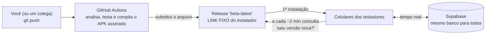

# Testar o app com outras pessoas (sem Google Play Console)

Guia para **você (desenvolvedor)** e para **quem vai testar**. Serve enquanto a verificação da conta de desenvolvedor da Google Play não é resolvida. Quando for resolvida, o caminho da Play continua em [PLAY_STORE.md](PLAY_STORE.md).

> **Em uma frase:** a cada `git push`, o GitHub compila o app sozinho, publica o instalador num **link fixo** e os celulares dos testadores **avisam dentro do app** que há versão nova.

---

## 1. Como funciona



| Peça | O que faz |
| :-- | :-- |
| **APK** | O "instalador" do app Android (como um `.exe` no Windows). |
| **Link fixo** | <https://github.com/Washington-Freitas/DesperrengueApp_TAI3/releases/download/beta-latest/desperrengue.apk> — **sempre** entrega a versão mais nova. Mande este link uma vez e pronto. |
| **Página do release** | <https://github.com/Washington-Freitas/DesperrengueApp_TAI3/releases/tag/beta-latest> — mostra a versão, o que mudou e o botão de baixar. |
| **Aviso no app** | Um cartão no topo: *"Nova versão disponível — Atualizar"*. Aparece poucos minutos depois da publicação e quando o app volta ao primeiro plano. |
| **Tempo real dos dados** | Todos usam o mesmo banco (Supabase): pedidos, orçamentos, chat e notificações aparecem na hora nos dois celulares. |

### O que é e o que NÃO é "automático"

* ✅ **Automático:** compilar, publicar e **avisar** os celulares (em ~2 minutos depois de a publicação terminar; a compilação leva ~8–10 min após o push).
* ⚠️ **Não é 100 % silencioso:** o Android **não permite** que um app se instale sozinho fora da Play Store (segurança do sistema). O testador confirma com **2 toques** (*Atualizar* → *Instalar*). Atualização totalmente silenciosa só existe pela Play Store.
* ⚠️ **iPhone:** este caminho é só **Android** (iPhone exige conta paga da Apple).

---

## 2. Passo a passo para o TESTADOR (mande este trecho a eles)

> **Você precisa de:** um celular Android e o link que o Wagner enviou.

### 2.1 Instalar (primeira vez)

1. **Abra o link no celular** (pelo WhatsApp mesmo). O download do arquivo `desperrengue.apk` (≈ 60 MB; use Wi‑Fi) começa sozinho.
2. Quando terminar, toque em **Abrir** na notificação (ou abra **Arquivos → Downloads** e toque no `.apk`).
3. O Android vai avisar *"Por segurança, seu telefone não está autorizado a instalar apps desta fonte"*:
   * toque em **Configurações**;
   * ligue **Permitir desta fonte**;
   * volte (seta `<`) e toque em **Instalar**.
4. Se aparecer **"Play Protect: app não verificado"**: toque em **Mais detalhes** → **Instalar mesmo assim**. (Esperado: o app ainda não está na Play Store.)
5. Toque em **Abrir**. Permita **localização** e **câmera** quando o app pedir.
6. **Entre com Google** ou crie uma conta e escolha **"Preciso de um serviço"** ou **"Quero trabalhar"**.

### 2.2 Atualizar (quando sair versão nova)

1. Ao abrir o app (ou voltar a ele), aparece no topo o cartão **"Nova versão disponível"**.
2. Toque em **Atualizar**. O navegador baixa o novo `desperrengue.apk`.
3. Toque na notificação de download → **Instalar** → **Abrir**.
Você **não perde** conta nem dados. Se tocar em **Depois**, o aviso volta na próxima vez que abrir o app.

### 2.3 Se algo der errado

| O que aparece | O que fazer |
| :-- | :-- |
| "App não instalado" | Falta espaço, ou a versão instalada veio de outra chave. Apague o Desperrengue e instale de novo (você só perde o login). |
| Não acha o arquivo baixado | Abra **Arquivos → Downloads**. |
| Botão "Instalar" cinza (Xiaomi/Samsung) | Desative temporariamente o *Bloqueador automático* (Samsung) ou a *Otimização MIUI* (Xiaomi). |
| O Google bloqueou o login | Use **e-mail e senha** (cadastro dentro do app). |
| O aviso de atualização não aparece | Feche e abra o app; confira a internet; aguarde 2–3 minutos. Ou abra o link fixo e instale por cima. |
| App fecha ao abrir | Mande um print e o modelo do celular ao Wagner. |

### 2.4 Regras do teste (importante)

* O app ainda é **teste**: o dinheiro é **fictício**. Cada cliente começa com **R$ 1.200,00 de crédito de teste** e recarrega por um **Pix de teste** (botão **"Simular pagamento Pix agora"**); os saques também são simulados. **Não pague o QR Code com o seu banco.**
* **Não use documentos reais** na verificação (KYC): tire foto de qualquer papel/cartão fictício.
* Os dados vão para o banco de teste do projeto. Evite informações sensíveis reais.

### 2.5 Roteiro de 5 minutos: carteira e pagamento (cliente)

1. Toque no **saldo** (chip no topo da tela inicial) → **Minha carteira**: saldo disponível, "Valor protegido em custódia" e extrato. O **👁️** esconde os valores.
2. Peça um serviço e aceite um orçamento. Em **Forma de pagamento**, o cartão **"Pagar com saldo da carteira"** mostra seu saldo, o valor e o **saldo depois** (ou quanto **falta**).
3. Se faltar, ao confirmar aparece **"Saldo insuficiente para este serviço"**. Toque em **"Adicionar R$ X agora ➔"**.
4. Toque em **Gerar Pix de Recarga** (aparecem o QR Code e o "copia e cola") e depois em **"Simular pagamento Pix agora"**.
5. Veja o **"Pix confirmado!"** e a volta ao pedido: o pagamento é aprovado sozinho e o valor fica **em custódia**.
6. Quando o profissional informar o **PIN** e concluir, o extrato mostra **"Pagamento liberado"**. Se cancelar antes, o valor **volta** ao saldo.

> Se algo parecer errado (saldo que não bate, Pix que não confirma), mande um print do extrato ao Wagner.

---

## 3. Passo a passo para VOCÊ (desenvolvedor)

### 3.1 No dia a dia: só faça o push

```powershell
git push origin <sua-branch>
```

* Branches que disparam o beta: **`main`** e **`fix/foundation-hardening`** (lista em [`beta-release.yml`](../.github/workflows/beta-release.yml)). Mudanças **só de documentação** (`*.md`, `docs/`, `supabase/`, `scripts/`) **não** disparam compilação.
* Acompanhe em **GitHub → aba Actions → "Beta (APK automático)"**. Verde = publicado. Vermelho = `flutter analyze`/`flutter test` falhou **e nada foi publicado** (os testadores continuam com a versão anterior, que funciona).

### 3.2 Publicar sem fazer push (botão manual)

GitHub → **Actions** → **Beta (APK automático)** → **Run workflow** → escolha a branch → **Run workflow**.
Ou pelo terminal: `gh workflow run beta-release.yml --ref main`.

### 3.3 Mudar a versão exibida

Em `app/pubspec.yaml`, altere só a parte antes do `+` (ex.: `0.2.0+2` → `0.3.0+2`). **Você não precisa mexer no número depois do `+`:** a CI usa os *minutos desde 1970* como `versionCode`, que **sempre cresce** (é o que o Android exige para aceitar a atualização).

### 3.4 Ver tudo acontecendo em tempo real

* **Dois celulares, dois papéis:** você entra como **Profissional** e o testador como **Cliente** (ou o contrário). Ele cria um pedido; no seu celular aparece **"Solicitações para você"** em segundos. Chat e notificações também são ao vivo.
* **Ver a tela dele:** peça para compartilhar a tela numa chamada de vídeo (WhatsApp/Meet).
* **Conferir os dados:** painel do Supabase → *Table Editor* → `jobs`, `quotes`, `payments`, `client_wallets`, `wallet_statement`.

### 3.5 Encerrar o teste

GitHub → **Releases** → `beta-latest` → **Delete**, e **desative** o workflow (Actions → Beta → ⋯ → *Disable workflow*). O link deixa de funcionar; quem já instalou continua com o app.

---

## 4. Segurança e limites

| Tema | Situação |
| :-- | :-- |
| **Chave de assinatura do beta** | É uma chave **só do beta** (`desperrengue-beta.jks`), **diferente** da chave de upload da Play. Fica nos *Secrets* do repositório (`BETA_KEYSTORE_B64`, `BETA_KEYSTORE_PASSWORD`) e em `%USERPROFILE%\.desperrengue\keys\`. Se vazar, o prejuízo é só do beta; a chave da Play continua intacta. **Faça backup** da pasta `keys\`. |
| Quem enxerga os *Secrets* | Quem tem permissão de escrita no repositório pode alterar um *workflow* e ler segredos. Dê escrita só a pessoas de confiança. Pull requests de *forks* **não** recebem segredos. |
| Quem pode baixar | **Qualquer pessoa com o link** (repositório público). O app exige login e o banco é protegido por RLS. Não divulgue o link em locais abertos. |
| Segredos dentro do APK | Só a URL e a chave **pública** (`sb_publishable_…`) do Supabase. |
| Autenticidade | O release mostra o **SHA‑256** do APK. |
| Beta ≠ Play Store | O APK beta e o app da Play têm assinaturas diferentes: quem passar para a versão da Play terá de **desinstalar** o beta antes. |
| Custo | **Zero** (GitHub Actions/Releases e Supabase no plano atual). |

Decisões e alternativas: [ADR-0017](adr/0017-distribuicao-beta-e-atualizacao-no-app.md). Alternativa futura: **Firebase App Distribution** (convite por e-mail e painel de quem instalou).
