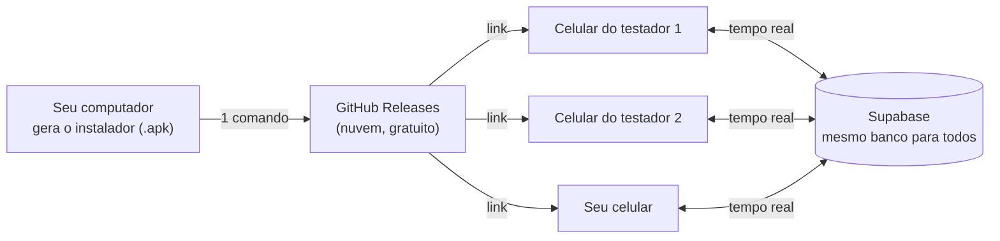

# Testar o app com outras pessoas (sem Google Play Console)

Guia para **você (desenvolvedor)** e para **quem vai testar**. Serve enquanto a verificação da conta de desenvolvedor da Google Play não é resolvida. Quando for resolvida, o caminho da Play continua em [PLAY_STORE.md](PLAY_STORE.md).

---

## 1. Como funciona (em 30 segundos)



* O **APK** é o "instalador" do app Android (como um `.exe` no Windows).
* Ele fica hospedado no **GitHub Releases** (a página de downloads do repositório). Ninguém precisa de conta: basta abrir o link.
* **Tempo real:** todos os celulares usam o **mesmo banco (Supabase)**. Quando um testador faz um pedido, você vê aparecer **na hora** no seu celular (e vice-versa): pedidos, orçamentos, chat e notificações.
* **iPhone:** este caminho é só **Android**. Para iPhone seria preciso conta paga da Apple (TestFlight).

---

## 2. Passo a passo para o TESTADOR (mande este trecho a eles)

> **Você precisa de:** um celular Android e o link que o Wagner enviou.

1. **Abra o link no celular** (pelo WhatsApp mesmo). Abre uma página do GitHub chamada *"Desperrengue beta"*.
2. Role até **Assets** (no fim da página) e toque em **`desperrengue-X.Y.Z.apk`**. O download começa (≈ 50 MB; use Wi‑Fi).
3. Quando terminar, toque em **Abrir** na notificação (ou abra o app **Arquivos → Downloads** e toque no `.apk`).
4. O Android vai avisar **"Por segurança, seu telefone não está autorizado a instalar apps desta fonte"**:
   * toque em **Configurações**;
   * ligue **Permitir desta fonte**;
   * volte (seta `<`) e toque em **Instalar**.
5. Se aparecer **"Play Protect: app não verificado / bloqueado"**:
   * toque em **Mais detalhes**;
   * toque em **Instalar mesmo assim**.
   (Isso acontece porque o app ainda não está na Play Store. É esperado.)
6. Toque em **Abrir**. Na primeira vez, **permita** localização e câmera quando o app pedir (são usadas para endereço e verificação).
7. **Entre com Google** ou crie uma conta e escolha **"Preciso de um serviço"** ou **"Quero trabalhar"**.

### Se algo der errado

| O que aparece | O que fazer |
| :-- | :-- |
| "App não instalado" | Falta espaço, ou já existe uma versão de outra origem. Apague o Desperrengue antigo e instale de novo. |
| Não acha o arquivo baixado | Abra **Arquivos → Downloads**. |
| Botão "Instalar" cinza (Xiaomi/Samsung) | Desative temporariamente o *Bloqueador automático* (Samsung) ou a *Otimização MIUI* (Xiaomi) nas configurações de segurança. |
| O Google bloqueou o login | Use **e-mail e senha** (cadastro dentro do app). |
| App fecha ao abrir | Mande um print e o modelo do celular ao Wagner. |

### Regras do teste (importante)

* O app ainda é **teste**: **pagamentos e saques são simulados** (nenhum dinheiro real se move).
* **Não use documentos reais** na verificação (KYC): tire foto de qualquer papel/cartão fictício.
* Os dados vão para o banco de teste do projeto. Evite informações sensíveis reais.

---

## 3. Passo a passo para VOCÊ publicar (e atualizar) o instalador

### 3.1 Primeira vez (já feito nesta máquina)

Pré-requisitos já prontos: Flutter, GitHub CLI logado (`gh auth status`) e a chave de upload em `app/android/key.properties`.

Abra o **PowerShell** na pasta do projeto e rode:

```powershell
cd C:\00_Desperrengue
powershell -ExecutionPolicy Bypass -File scripts\publicar-beta.ps1
```

O script faz tudo sozinho (leva ~5 min): compila o APK **assinado**, calcula o SHA‑256, cria o *Release* `beta-vX.Y.Z` no GitHub e **imprime o link** no final. Copie o link e mande aos testadores.

### 3.2 Enviar uma versão nova (correções)

1. Edite `app/pubspec.yaml` e **aumente** a versão: `version: 0.2.0+2` → `version: 0.2.1+3`. (O número depois do `+` **sempre** sobe; senão o Android recusa a atualização.)
2. Rode de novo `scripts\publicar-beta.ps1`.
3. Mande o novo link. O testador instala **por cima**: **não perde** conta nem dados.

> **Nunca troque a chave de upload** (`desperrengue-upload.jks`). Com outra chave o Android não deixa atualizar por cima (o testador teria de desinstalar). Faça o backup descrito em [PLAY_STORE.md](PLAY_STORE.md#1-faça-backup-da-chave-de-upload-faça-hoje).

### 3.3 Ver tudo acontecendo em tempo real

* **Dois celulares, dois papéis:** você entra como **Profissional** e o testador como **Cliente** (ou o contrário). Ele cria um pedido; no seu celular aparece **"Solicitações para você"** em segundos. O chat e as notificações também são ao vivo.
* **Ver a tela dele:** peça para compartilhar a tela numa **chamada de vídeo do WhatsApp/Meet**. Assim você vê o celular dele e o seu ao mesmo tempo.
* **Conferir os dados:** no painel do Supabase (*Table Editor*) você vê `jobs`, `quotes`, `payments` mudando em tempo real.

### 3.4 Encerrar o teste

Para tirar o instalador do ar: GitHub → **Releases** → abra o release → **Delete**. (O link deixa de funcionar; quem já instalou continua com o app.)

---

## 4. Segurança e limites (leia uma vez)

| Tema | Situação |
| :-- | :-- |
| Quem pode baixar | **Qualquer pessoa com o link** (o repositório é público). O app em si exige login e o banco é protegido por RLS. Não publique o link em locais abertos. |
| Segredos no APK | Só a URL e a chave **pública** (`sb_publishable_…`) do Supabase, que é pública por design. A chave de upload **nunca** vai ao GitHub. |
| Autenticidade | O release mostra o **SHA‑256** do arquivo; quem quiser conferir compara. |
| Custo | **Zero** (GitHub Releases e Supabase no plano atual). |
| Limite de testadores | Sem limite técnico. Cuidado com o plano gratuito do Supabase (usuários ativos/armazenamento). |
| Quando voltar à Play | Faça o teste interno ([PLAY_STORE.md](PLAY_STORE.md)): ele dá atualizações automáticas e até 100 testadores por convite. |

## 5. Alternativa futura: Firebase App Distribution

Também gratuito: convida testadores **por e-mail**, avisa quando sai versão nova e mostra quem instalou. Exige criar um projeto no Firebase; fica como evolução se o grupo de testadores crescer.
