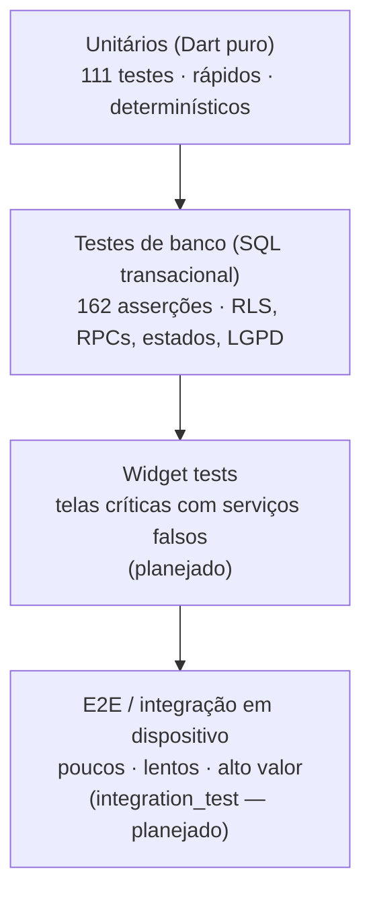

# TESTING — Estratégia de Garantia da Qualidade

> **Escopo.** Define o que testamos, em que camada, com quais ferramentas, com que critérios de saída e como executar. Estrutura alinhada à **ISO/IEC 25010** (modelo de qualidade do produto) e às práticas da **ISO/IEC/IEEE 29119** (testes de software).
> **Princípio.** *Risco dita a profundidade.* Onde há **dinheiro, identidade, privacidade ou concorrência**, o teste é automatizado e roda **no banco**, que é a fronteira de confiança ([ADR-0003](adr/0003-regras-de-negocio-no-banco-via-rpc.md)).

## Sumário

1. [Modelo de camadas (pirâmide)](#1-modelo-de-camadas-pirâmide)
2. [Estado atual (medido)](#2-estado-atual-medido)
3. [Testes unitários (Flutter)](#3-testes-unitários-flutter)
4. [Testes de banco: smoke de segurança e regras](#4-testes-de-banco-smoke-de-segurança-e-regras)
5. [Testes de widget e integração (planejados)](#5-testes-de-widget-e-integração-planejados)
6. [Testes manuais em dispositivo](#6-testes-manuais-em-dispositivo)
7. [Dados de teste e higiene do ambiente](#7-dados-de-teste-e-higiene-do-ambiente)
8. [Metas de cobertura e critérios de saída](#8-metas-de-cobertura-e-critérios-de-saída)
9. [Rastreabilidade requisitos ↔ testes](#9-rastreabilidade-requisitos--testes)
10. [Mapeamento ISO/IEC 25010](#10-mapeamento-isoiec-25010)
11. [Gestão de defeitos](#11-gestão-de-defeitos)
12. [Como executar](#12-como-executar)

---

## 1. Modelo de camadas (pirâmide)



| Camada | Local | Ferramenta | Alvo |
| :-- | :-- | :-- | :-- |
| Unitário | `app/test/` | `flutter_test` | Modelos puros, roteamento (`destinationFor`), formatação, cálculos |
| Banco | `supabase/tests/security_smoke.sql` | SQL/PL-pgSQL em transação abortada | RLS, `GRANT`, RPCs, invariantes, concorrência lógica |
| Widget | `app/test/widgets/` *(a criar)* | `flutter_test` + *fakes* de serviço | Telas críticas: PIN, wizard, pagamento |
| Integração/E2E | `app/integration_test/` *(a criar)* | `integration_test` | Fluxo feliz cliente→profissional→conclusão |
| Manual exploratório | roteiro (§6) | emulador + aparelho real | Câmera, OAuth, deep link, UX |

**Regra de ouro:** o **cliente é considerado hostil**; portanto a segurança **não** é validada por testes de UI, e sim por testes de banco que simulam `authenticated` e `anon` com `request.jwt.claims` + `SET LOCAL ROLE`.

---

## 2. Estado atual (medido)

*Medição de 2026-10-29 (`flutter test --coverage`).*

| Indicador | Valor |
| :-- | :-- |
| Testes unitários e de *widget* | **111**, todos aprovados |
| Asserções SQL | **162** (`security_smoke` 62 + `review_system_smoke` 30 + `achievements_smoke` 22 + `offboarding_showcase_smoke` 48), `FALHAS = 0` |
| Teste do Dossiê PDF (Node) | **7**, aprovados (`node scripts/test-dossie.mjs`) |
| E2E da Edge Function `excluir-conta` | 401 sem sessão · 400 sem confirmação · 409 com saldo · 200 após o saque (e-mail aceito pelo Resend, dados e conta removidos) — executado manualmente com usuário de teste |
| `flutter analyze` | **0** avisos |
| Cobertura de linhas nos 19 arquivos com teste dedicado (≥ 40 % de linhas cobertas: modelos, tokens/tema, boot, sessão segura, `LocalPrefs`, `PrivacyMode`, seleção de perfil, tela de Pix, splash…) | **978 / 1197 = 81,7 %** |
| Tamanho do código do app | 76 arquivos Dart, ≈ 19,7 mil linhas |
| Cobertura **global** (todas as linhas dos 73 arquivos que o `lcov` enxerga) | **14,4 % (1117 / 7770)** — subiu, mas ainda é baixa: a maioria das telas e serviços não tem teste; meta e plano em §8 |

> Declaramos explicitamente que a cobertura global é **inferior** à da camada testada: o número de 81,7 % **não** representa o projeto inteiro (apenas 19 dos 76 arquivos têm teste dedicado; o global é 14,4 %).

---

## 3. Testes unitários (Flutter)

**Onde:** `app/test/*.dart`. **O que cobrir:** lógica pura e determinística.

Cobertos hoje (`app/test/user_profile_test.dart`):

* `VerificationStatus.parse` (todos os valores do *enum* do banco; valores desconhecidos → `NOT_SUBMITTED`).
* `UserProfile.fromMap`, `autoMode` (um modo → entra direto; dois modos → escolhe).
* **`destinationFor`**: usuário novo, dois modos, "trocar de modo", cadastro de cliente, máquina de estados do KYC, cliente que vira profissional, admin.
* Formatação: `brl`, `parseBrl`, `clock`, `relativeTime`, `distanceKm`.
* Modelos de domínio: `Job.fromMap`, `JobStatus`, `ProviderCard`.

**Convenções**

* Um arquivo de teste por unidade (`<unidade>_test.dart`); `group` por responsabilidade; nomes descrevem **comportamento** ("profissional segue a máquina de estados do KYC").
* **Sem rede, sem relógio real, sem aleatoriedade**: injete `now` (ex.: `relativeTime(d, now: …)`).
* Padrão **AAA** (*Arrange–Act–Assert*); uma intenção por teste.
* Teste de bug: **escreva o teste que falha antes da correção**.

---

## 4. Testes de banco: smoke de segurança e regras

**Arquivo:** `supabase/tests/security_smoke.sql` — executa **tudo em uma única transação que é sempre abortada** (`RAISE EXCEPTION` carrega o relatório); portanto **não grava dados**. Simula usuários trocando de papel (`pg_temp.login(uuid)`), registra resultados em tabela temporária e imprime `ok`/`FAIL`.

| Bloco | Asserções (nº) | Verifica |
| :-- | :-: | :-- |
| Segurança de perfil | 01–04 | Auto-aprovação de KYC, escalada para admin, mudança direta de flags e de nota — **bloqueadas** |
| Multi-modo | 05–07 | Mesma conta vira cliente **e** profissional; `enroll_mode('admin')` rejeitado |
| Convites e visibilidade | 08–15 | `provider_id` não definível na criação; limite de 3 convites; não convidado não vê pedido nem endereço |
| Orçamentos | 16–20, 48–51 | Um por profissional; privacidade entre concorrentes; limite de 3; retirar libera vaga |
| Aceite e custódia | 21–31 | Não paga antes do aceite; método inválido; `awaiting_payment` → `in_progress` + `escrow`; PIN visível só ao dono; `status` só por RPC |
| Execução e PIN | 32–39 | Evidência só do contratado; PIN errado **persiste a tentativa**; PIN correto libera; comissão 12 % (R$ 132 de R$ 150) |
| Avaliações | 40–44 | Única por parte; terceiros não avaliam; nota agregada atualizada |
| Chat | 45–47 | Só participantes; conversas isoladas |
| Emergência | 52–57 | Reserva antes do aceite; só o convidado aceita; PIN gerado; **estorno** por expiração e por cancelamento |
| Suporte/disputa | 58–61 | Chamado congela o serviço; privado; só admin resolve; devolução ao cliente |
| Acesso anônimo | 62–63 | `anon` sem acesso a `jobs` e às views |

**Como estender (obrigatório em PRs de banco):**

1. Adicione blocos seguindo o padrão `begin … perform pg_temp.t(true|false, 'NN descrição') … exception when others then …`.
2. Para cada nova tabela: **pelo menos um teste de acesso negado** (usuário sem relação, `anon`).
3. Para cada nova RPC: caso feliz, caso de não autorizado e caso de estado inválido.
4. Mantenha a numeração; o relatório ordena por `n`.

**Executar:**

```bash
supabase db query --linked -f supabase/tests/security_smoke.sql
supabase db query --linked -f supabase/tests/review_system_smoke.sql   # avaliações cegas, Bayes, selos e respostas (30 asserções)
supabase db query --linked -f supabase/tests/achievements_smoke.sql      # conquistas: desbloqueio, escala e privacidade (22 asserções)
supabase db query --linked -f supabase/tests/offboarding_showcase_smoke.sql  # carteira/Pix, exclusão LGPD e vitrine LIFO (48 asserções)
# A saída é uma "falha" proposital contendo o relatório; o critério é "FALHAS=0".
```

Requisito: ≥ 6 linhas em `public.profiles` (as contas existentes servem de "atores"; os papéis são ajustados **dentro** da transação).

---

## 5. Testes de widget e integração (planejados)

| Item | Abordagem |
| :-- | :-- |
| **Widget tests** | Injetar *fakes* dos serviços (`JobService`, `ProviderService`…) — hoje as telas instanciam serviços diretamente; o primeiro passo é permitir injeção por construtor/provider. Prioridade: teclado de PIN (estados erro/bloqueio), wizard (validações), pagamento (aviso de demonstração) |
| **`integration_test`** | Fluxo feliz: login → cliente cria pedido → profissional orça → cliente paga → profissional conclui com PIN → avaliações. Executar contra **projeto de *staging*** (E-08 do [ROADMAP](ROADMAP.md)), nunca contra produção |
| **Golden tests** | Telas estáveis do design system (cartões, banners) para evitar regressões visuais |

---

## 6. Testes manuais em dispositivo

Obrigatórios antes de cada entrega (e a cada mudança em permissões, OAuth ou deep links).

**Matriz mínima:** Android emulador (API recente) · 1 aparelho Android físico · iOS (simulador e, quando possível, físico).

**Roteiro de aceitação (resumo):**

| # | Cenário | Resultado esperado |
| :-: | :-- | :-- |
| 1 | Cadastro por e-mail + **OTP** | Código chega (Resend); conta criada; seleção de modo |
| 2 | Login com **Google** | Retorno por `br.com.desperrengue.app://login-callback`; sessão ativa |
| 3 | **KYC**: documento (frente/verso), selfie, registro, envio | Estado `PENDING` → aprovado (mock/admin) → e-mail |
| 4 | **Deep link** do e-mail de aprovação | App abre e reconsulta o status; ativação |
| 5 | Cliente: pedido direto agendado com **foto da câmera** | Pedido criado; convite com contagem de 2 h |
| 6 | Profissional: orçamento | Comissão exibida; cliente é notificado |
| 7 | Aceite + pagamento simulado | Custódia; PIN visível **só** ao cliente |
| 8 | Evidências (4 fotos) e PIN errado/correto | Mensagem de tentativas; sucesso libera custódia |
| 9 | **Emergência** | Radar 5 min; aceite → *match*; recusa/expiração → estorno |
| 10 | **Mesma conta** nos dois modos | Troca de modo sem novo cadastro |
| 11 | Permissões negadas (câmera/localização) | Mensagem amigável; app não quebra |
| 12 | Sem rede / rede intermitente | Estado de erro com "Tentar novamente" |
| 13 | Rotação de tela, tema, textos longos | Sem *overflow* |
| 14 | Acessibilidade (fonte grande, TalkBack) | Fluxos principais utilizáveis |

Registre resultado, build e dispositivo no PR (ou em planilha de QA).

**Limitações do emulador:** Google OAuth exige conta Google no AVD; a câmera é "cena virtual".

---

## 7. Dados de teste e higiene do ambiente

O backend é **compartilhado** (sem *staging*): testes manuais criam dados reais no banco. Regras:

1. Use e-mails do domínio reservado **`@example.com`** (ex.: `qa.cliente@example.com`) — nunca enviam e-mail.
2. **Limpe ao terminar.** Os dados dependentes caem em cascata, exceto pagamentos (remova os pedidos antes) e arquivos do Storage.

Criar contas de teste com senha (somente em ambiente de desenvolvimento controlado):

```sql
with u as (
  insert into auth.users (instance_id,id,aud,role,email,encrypted_password,email_confirmed_at,
                          raw_app_meta_data,raw_user_meta_data,created_at,updated_at,
                          confirmation_token,email_change,email_change_token_new,recovery_token)
  select '00000000-0000-0000-0000-000000000000', gen_random_uuid(),'authenticated','authenticated', e,
         crypt('<defina-uma-senha>', gen_salt('bf')), now(),
         '{"provider":"email","providers":["email"]}'::jsonb, jsonb_build_object('full_name', n), now(), now(), '', '', '', ''
    from (values ('qa.cliente@example.com','QA Cliente'), ('qa.profissional@example.com','QA Profissional')) v(e,n)
  returning id, email)
insert into auth.identities (id,user_id,provider_id,identity_data,provider,last_sign_in_at,created_at,updated_at)
select gen_random_uuid(), id, id::text, jsonb_build_object('sub',id::text,'email',email,'email_verified',true),
       'email', now(), now(), now() from u;
```

Para tornar um profissional de teste **ativo** sem passar pelo KYC: `update public.profiles set is_provider=true, verification_status='ACTIVE', provider_setup_done=true where id=…;` e inserir `provider_profiles`.

**Remoção:**

```sql
delete from public.jobs where client_id in (select id from auth.users where email like 'qa.%@example.com')
                          or provider_id in (select id from auth.users where email like 'qa.%@example.com');
delete from auth.users where email like 'qa.%@example.com';
```

```bash
supabase storage rm -r "ss:///job-media/<uid>" --linked --experimental --yes
```

---

## 8. Metas de cobertura e critérios de saída

**Política de cobertura (alvo para o MVP — E-06 do [ROADMAP](ROADMAP.md)):**

| Escopo | Meta de linhas | Justificativa |
| :-- | :-: | :-- |
| `core/models`, `core/utils` | ≥ **85 %** | Lógica pura, barata de testar |
| `core/services` | ≥ **60 %** (com *fakes* do cliente Supabase) | Contratos com o banco |
| `features/**` (telas) | ≥ **35 %** (widgets críticos) | Retorno decrescente |
| **Global** | ≥ **50 %** | Piso para entrega |
| **Banco** | **100 % das RPCs** com caso feliz e de negação; **100 % das tabelas** com teste de acesso negado | Fronteira de confiança |

> A cobertura é **indicador**, não objetivo: não aceitamos testes sem asserção para "inflar" números.

**Critérios de saída para um *release* (MVP):**

* `flutter analyze` = 0; `flutter test` = 100 % aprovado; `security_smoke.sql` com `FALHAS=0`.
* Roteiro manual (§6) executado em ≥ 1 aparelho físico, sem defeitos **críticos/altos** abertos.
* Nenhum KYC aprovado automaticamente em produção (`kyc_auto_approve = 'false'`).
* Sem segredos no repositório (verificação manual do PR e *scan* de histórico).

---

## 9. Rastreabilidade requisitos ↔ testes

*(Requisitos em `docs/Especificação do Projeto.md`; mapeamento resumido.)*

| Requisito | Verificação principal |
| :-- | :-- |
| RF — Cadastro/autenticação com verificação de e-mail | Manual #1–#2; `destinationFor` (unit) |
| RF — Verificação do profissional (KYC) | Smoke 01–03; manual #3–#4 |
| RF-04 — Máx. 3 orçamentos por demanda | Smoke 10–11, 48, 51 |
| RF-05 — Aceite e contratação | Smoke 21–26; manual #7 |
| RF-07 — Só profissional verificado orça | Smoke 14, 20, 49 |
| Escrow/liberação por conclusão | Smoke 26–39 |
| RNF-04 — Prestadores não veem orçamentos concorrentes | Smoke 18 |
| Privacidade (LGPD — minimização) | Smoke 12–13, 29–30, 59 |
| Disputa e mediação | Smoke 58–61; manual #9 |
| Multi-modo (mesma conta) | Smoke 05–07; unit `destinationFor`; manual #10 |

---

## 10. Mapeamento ISO/IEC 25010

| Característica | Como é avaliada |
| :-- | :-- |
| Adequação funcional | Roteiro de aceitação; rastreabilidade (§9) |
| **Segurança** | Smoke de banco (62); revisão de RLS em PR; política em [SECURITY](../.github/SECURITY.md) |
| **Confiabilidade** | Estorno automático (cron), idempotência de RPCs, tentativas de PIN persistidas; testes de falha de rede (manual #12) |
| Usabilidade | Roteiro (§6 #11–#14); estados de erro/vazio; contraste e alvos de toque |
| Eficiência de desempenho | *Smoke* de tempo de resposta em consultas principais (planejado); índices parciais |
| Manutenibilidade | `analyze` sem avisos; camadas e testabilidade (ver [ARCHITECTURE](ARCHITECTURE.md)) |
| Portabilidade/Compatibilidade | Matriz de dispositivos; deep links Android/iOS |

---

## 11. Gestão de defeitos

| Severidade | Definição | Exemplo | Meta de correção |
| :-- | :-- | :-- | :-- |
| **Crítica** | Perda/exposição de dados, dinheiro incorreto, bloqueio total | Auto-aprovação de KYC; estorno ausente | Imediata (*hotfix*) |
| **Alta** | Fluxo principal quebrado sem contorno | PIN nunca bloqueia | ≤ 2 dias úteis |
| **Média** | Fluxo secundário ou com contorno | Texto em inglês no calendário | Próximo *sprint* |
| **Baixa** | Cosmético | Alinhamento de ícone | Backlog |

Todo defeito vira *issue* (template **Bug**), com passos de reprodução, ambiente e evidência; correções começam por **um teste que reproduz o erro**.

---

## 12. Como executar

```bash
# Unitários + cobertura
cd app
flutter analyze
flutter test --coverage        # relatório em app/coverage/lcov.info

# Banco (relatório de 162 asserções)
cd ..
supabase db query --linked -f supabase/tests/security_smoke.sql
supabase db query --linked -f supabase/tests/review_system_smoke.sql   # avaliações cegas, Bayes, selos e respostas (30 asserções)
supabase db query --linked -f supabase/tests/achievements_smoke.sql      # conquistas: desbloqueio, escala e privacidade (22 asserções)
supabase db query --linked -f supabase/tests/offboarding_showcase_smoke.sql  # carteira/Pix, exclusão LGPD e vitrine LIFO (48 asserções)

# Dossiê de Despedida (PDF) — roda em Node, sem Deno
node scripts/test-dossie.mjs
```

**Integração contínua:** o *workflow* [`.github/workflows/ci.yml`](../.github/workflows/ci.yml) executa `flutter analyze` e `flutter test --coverage` (e `node scripts/test-dossie.mjs`) a cada PR e *push* em `main`, publicando o `lcov.info` como artefato. O teste de banco **não** roda no CI (exige credenciais de projeto); ele é executado localmente e a **saída é anexada ao PR** de banco — a automação com *staging* está no [ROADMAP](ROADMAP.md) (E-08).
