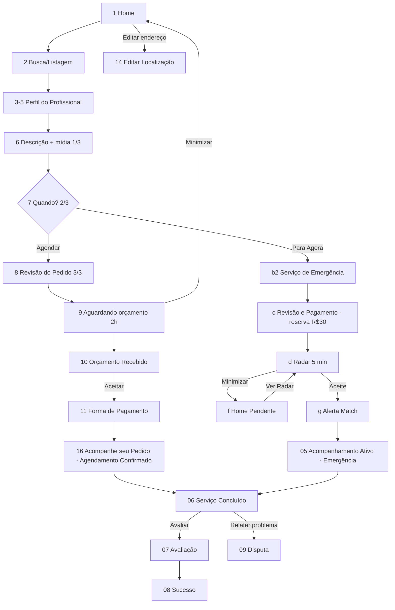

# Desperrengue — Telas do Cliente (Jornada Principal)

> Fonte: `docs/ui_ux/hi-fi_prototyping/cliente/8_Jornada_Principal_do_Cliente` (23 JPGs, mockups em iPhone). Cores em hex aproximado, estimadas visualmente.
> Padrão global: fundo branco/off-white `#FFFFFF`/`#FAFAFA`; laranja primário `#F26B0F` (~`#FF6B00`); texto `#111827`; cinza secundário `#6B7280`; chips cinza `#F1F3F5`; azul "verificado" `#1D6FE0` sobre `#E3EEFC`. Fonte sans (Roboto/Inter). Bottom nav: **Início / Meus Pedidos / Perfil**.

---

## 1.jpg — Home do Cliente
**(1) Propósito/momento:** Tela inicial pós-login; ponto de partida do pedido e atalho para serviço em andamento.
**(2) Textos:** `Desperrengue` · `Olá, Wagner! 👋` · `Rua Augusta, 1400 - Consolação ⌄` · placeholder `Do que você precisa hoje? (ex: eletricista)` · `Serviço em Andamento` · `Seu eletricista Marcos Silva está a caminho!` · `Acompanhar →` · `Resolva seu primeiro "desperrengue"!` · `Ganhe R$ 15 OFF` · `Cupom: PRIMEIRA15` · `Categorias` · `Elétrica` `Encanador` `Limpeza` `Montagem` `Pintura` `Chaveiro` · nav: `Início` `Meus Pedidos` `Perfil`.
**(3) Layout:** Status bar → header (logo laranja à esq., sino com badge vermelho à dir.) → saudação H1 + seletor de endereço (pin laranja + chevron) → barra de busca (lupa) + botão quadrado de filtros (ícone sliders) → card "Serviço em Andamento" (ponto laranja pulsante, avatar redondo do profissional, texto, link "Acompanhar →") → banner promo (ilustração de ferramentas à dir., cupom em caixa tracejada) → título "Categorias" → grid 3 colunas de círculos pastel com ícone (amarelo=Elétrica, azul=Encanador, verde=Limpeza, roxo=Montagem, rosa=Pintura, verde-claro=Chaveiro) → bottom nav 3 abas (Início ativo laranja).
**(4) Cores/raios:** card andamento fundo `#FDE8D8` borda `#F9B98A` raio ~16; banner gradiente `#FFF1E6→#FFE0CC` raio ~16; busca `#EEF1F5` raio ~14; círculos categoria ~Ø64 pastéis (`#FFF1B8`, `#D6E8FB`, `#D3F0DF`, `#E4D6F5`, `#FBD3E0`, `#D9F0C8`).
**(5) Ações:** sino → notificações; endereço → seletor/gerenciar endereços; busca/filtro → listagem (2.jpg); "Acompanhar →" → Acompanhamento Ativo (tela 05_TL_E); banner/cupom → copiar/aplicar cupom (provável); categoria → listagem filtrada (2.jpg); abas → Início/Meus Pedidos/Perfil.
**(6) Dados dinâmicos:** nome do cliente, endereço ativo, pedido em andamento (existência, status, profissional: nome+foto), contagem de notificações, promoções/cupons ativos, lista de categorias.

---

## 2.jpg — TL_B Busca e Listagem (Fase 1: Descoberta e Contratação)
**(1) Propósito:** Resultado de busca "Eletricista"; escolha do profissional.
**(2) Textos:** busca `Eletricista` (com ✕) · `Resultados para "Eletricista"` · chips `Mais próximos 📍` (ativo) `Maior nota ★` `Menor taxa…` (cortado, scroll horizontal) · `Marcos Silva` / `Eletricista Parceiro` / `4.9 ★ (84)` / `Perfil Verificado` / `Taxa de visita: R$ 30,00 • 1,2 km` · `Carlos Souza` / `Eletricista Residencial` / `4.8 ★ (120)` / `🔥 Super Profissional` / `R$ 40,00 • 2,5 km` · `Roberto Dias` / `Eletricista e Reparos` / `4.7 ★ (45)` / `Perfil Verificado` / `R$ 35,00 • 3,1 km` · `André Santos` (4º card cortado) · nav com Início ativo.
**(3) Layout:** app bar (seta voltar, campo de busca com X, botão filtros) → título de resultados → linha de chips de ordenação (horizontal scroll) → lista vertical de cards: avatar circular 60 à esq.; nome bold, especialidade, linha nota+badge, linha taxa+distância → bottom nav.
**(4) Cores/raios:** chip ativo `#F26B0F` texto branco, pílula; chips inativos `#EEF1F5`; card branco borda `#E5E7EB` raio ~16; badge verificado azul pílula; badge Super Profissional `#FFE9D6` texto laranja com ícone de chama; estrelas `#F59E0B`.
**(5) Ações:** voltar → Home; X → limpa busca; filtros → bottom sheet de filtros (não mostrado); chip → reordena; card → Perfil do Profissional (3.jpg).
**(6) Dados:** termo, lista de profissionais (foto, nome, título, nota média, nº avaliações, selo verificado/super profissional, taxa de visita, distância calculada ao endereço do cliente), ordenação ativa.

---

## 3.jpg — TL_C Perfil do Profissional (a)
**(1) Propósito:** Perfil público do prestador (topo); decidir solicitar.
**(2) Textos:** `Marcos Silva` (🔔 laranja + selo azul) · `Eletricista Parceiro` · `4.9` + 5 estrelas · `(125 avaliações)` · `150 serviços finalizados` · `Sobre o Profissional` · `Eletricista especializado em instalações residenciais e comerciais. Com vasta experiência em manutenção elétrica, fiação, quadros de distribuição e reparos. Ofereço serviço rápido, seguro e com garantia de qualidade para resolver qualquer perrengue elétrico!` · `Portfólio` (início) · rodapé `Taxa de visita: R$ 30,00` + botão `Solicitar Serviço >`.
**(3) Layout:** hero foto ~40% altura com botões circulares translúcidos (voltar à esq.; sino com badge e compartilhar à dir.) → avatar circular grande sobreposto na borda do sheet branco de cantos superiores arredondados → nome+ícones, título laranja → card de estatísticas em 2 colunas (nota/estrelas/avaliações | ✓ laranja grande + serviços finalizados) com sombra → seção "Sobre" → "Portfólio" → footer fixo com taxa e CTA.
**(4) Cores:** sheet raio ~24 topo; card stats branco sombra raio ~16; CTA `#F26B0F` pílula texto branco; título profissão `#E8650A`; valor taxa laranja bold.
**(5) Ações:** voltar; sino (favoritar/seguir/avisar — ambíguo); compartilhar; `Solicitar Serviço >` → fluxo de pedido (detalhar problema/checkout).
**(6) Dados:** foto de capa, avatar, nome, título, verificado, nota, nº avaliações, serviços finalizados, bio, taxa de visita.

---

## 4.jpg — TL_C Perfil do Profissional (b, scroll)
**(1) Propósito:** Perfil rolado: portfólio antes/depois.
**(2) Textos:** header colapsado `Marcos Silva` / `Eletricista Parceiro` · `Portfólio` · `Revisão de Fiação (Antes/Depois)` · `Troca de Disjuntor (Antes/Depois)` · tags `Antes` / `Depois` nas fotos · `Reviews Recentes` (título cortado) · footer igual (`Taxa de visita: R$ 30,00` / `Solicitar Serviço >`).
**(3) Layout:** app bar colapsada branca (voltar, mini avatar, nome+título, sino, compartilhar) → seção Portfólio com subtítulo por trabalho → par de fotos quadradas lado a lado (carrossel horizontal com seta `>` circular branca flutuante) com tag escura translúcida "Antes"/"Depois" → próximo trabalho → "Reviews Recentes" → footer fixo.
**(4) Cores:** thumbs raio ~16; tags `rgba(0,0,0,.6)` texto branco pílula.
**(5) Ações:** seta `>` → próximo par/ver mais; foto → visualizador (provável); CTA como em 3.
**(6) Dados:** trabalhos de portfólio (título, foto antes, foto depois), reviews recentes.

---

## 5.jpg — TL_C Perfil do Profissional (c, fim do scroll)
**(1) Propósito:** Reviews recentes de clientes anteriores.
**(2) Textos:** header colapsado (`Marcos Silva` / `Eletricista Parceiro`) · `Reviews Recentes` · `Ana P.` `Há 2 dias` ★★★★★ `Ótimo serviço! Resolveu o curto muito rápido. Recomendo!` · `Carlos M.` `Há 1 semana` ★★★★★ `Pontual e profissionalismo. Fiação perfeita. Recomendo o Marcos!` · footer `Taxa de visita: R$ 30,00` / `Solicitar Serviço >`.
**(3) Layout:** app bar colapsada → título → cards de review (avatar circular 52, nome bold, tempo relativo à direita cinza, 5 estrelas amarelas `#FBBF24`, texto) → footer fixo.
**(4) Cores:** cards brancos com sombra suave, raio ~16.
**(5) Ações:** CTA → fluxo de pedido (6.jpg). Sem "ver todas" visível.
**(6) Dados:** reviews (nome abreviado, avatar, nota, comentário, data relativa).

---

## 6.jpg — TL_D Checkout e Agendamento 01 Descrição (passo 1/3)
**(1) Propósito:** Cliente descreve o problema e anexa mídia ao solicitar orçamento a um profissional escolhido (fluxo "agendado").
**(2) Textos:** `1 de 3: O que precisa ser feito?` · `Marcos Silva` `Eletricista Parceiro` `4.9 ★` (selo) · `O que precisa ser feito? (Obrigatório)` · placeholder `Ex: Meu disjuntor do chuveiro está desarmando toda vez que ligo na temperatura quente...` · contador `0 / 500` · `Anexar fotos ou vídeos (Até 4) (Obrigatório)` · `(1/4)` · `+ Adicionar` · botão `Avançar para Data e Hora`.
**(3) Layout:** app bar (voltar circular escuro + título do passo) → stepper de 3 segmentos (1 laranja, 2 cinza) → card mini-perfil do profissional → label → textarea grande (borda cinza, raio ~16) com contador → label mídia + contador → linha: tile tracejado "+ Adicionar" + miniatura com X de remover → CTA fixo no rodapé full-width.
**(4) Cores:** CTA `#EA6A0A` pílula (raio ~28); stepper ativo laranja, inativo `#E5E7EB`; tile tracejado `#F3F4F6`.
**(5) Ações:** voltar → perfil; Adicionar → câmera/galeria; X → remove mídia; CTA → 7.jpg (provável desabilitado até texto + ≥1 mídia).
**(6) Dados:** profissional escolhido, texto (≤500), mídias (≤4, fotos/vídeos).

---

## 7.jpg — TL_D Checkout e Agendamento (passo 2/3, Data e Hora)
**(1) Propósito:** Escolher "Para Agora" (emergência) ou "Agendar".
**(2) Textos:** `2 de 3: Quando será o serviço?` · `Quando deseja o atendimento?` · toggle `⚡ Para Agora` / `📅 Agendar` (ativo) · `Seção de Agendamento` · `Outubro 2026` (setas ‹ ›) · `D S T Q Q S S` · dias 1–30 (sáb/dom e dias passados riscados/cinza; 15 selecionado) · `Horários disponíveis para o dia selecionado` · `Grade de Horários` · chips `08:00` `11:00` `14:00` (selecionado) `15:30` `09:30` (indisp.) `14:30` `14:30`(indisp.) · botão `Avançar para Resumo do Pedido →`.
**(3) Layout:** app bar + stepper (2 laranja, 1 cinza) → pergunta → segmented control de 2 pílulas → título seção → calendário mensal 7 colunas (dia selecionado círculo laranja) → título + grade de chips de horário (wrap, 4 por linha) → CTA fixo.
**(4) Cores:** "Agendar" ativo `#EA6A0A` texto branco; "Para Agora" `#EEEEEE` borda cinza; chips: borda `#111` raio ~20 branco, selecionado laranja, indisponível cinza `#E5E7EB` texto riscado.
**(5) Ações:** Para Agora → fluxo emergência (radar 04_TL_D_..._e); Agendar → mostra calendário; setas mês; dia → recarrega horários; chip → seleciona; CTA → 8.jpg.
**(6) Dados:** disponibilidade do profissional por dia/horário (indisponíveis marcados), mês corrente.
**Observação:** Há inconsistência no mock: seleção 14:00 vs resumo 14:30 (8.jpg); chip `14:30` aparece duplicado (um indisponível).

---

## 8.jpg — TL_D Revisão do Pedido (passo 3/3)
**(1) Propósito:** Confirmar e enviar pedido de orçamento (agendado).
**(2) Textos:** `Revisão do Pedido` · `Profissional` · `3 de 3: Revisão` · `Marcos Silva` `Eletricista Parceiro` `4.9 ★` · `O que precisa ser feito?` · `Preciso de um eletricista para trocar o disjuntor do chuveiro que está desarmando toda vez que ligo na temperatura quente...` (+ miniatura com X) · `Compromisso Agendado` · `Quinta-feira, 15 de Outubro às 14:30` · tag `SERVIÇO AGENDADO` · info `Marcos terá até 2 horas para analisar o seu problema e enviar o orçamento final.` · botão `Enviar Pedido de Orçamento ✈`.
**(3) Layout:** app bar + stepper 3/3 completo → cabeçalho "Profissional / 3 de 3: Revisão" → card profissional → card descrição + mídia → card compromisso (ícone calendário laranja, data, faixa azul-clara com tag) → faixa informativa azul (ícone i) → CTA fixo.
**(4) Cores:** faixa info/tag `#DCEBFA` texto `#1B5FA8`; CTA laranja `#EA6A0A`; cards borda cinza raio ~16.
**(5) Ações:** voltar; X na miniatura → remover mídia; CTA → envia pedido → Home com status pendente (04_TL_D_..._f_Home_Pendente).
**(6) Dados:** profissional, descrição, mídias, data/hora agendada, SLA de orçamento (2h).
**Nota:** Orçamento é **final, enviado pelo profissional após análise** (taxa de visita só no perfil).

---

## 9.jpg — Aguardando Orçamento (timer 2h)
**(1) Propósito:** Pós-envio do pedido (agendado); espera da resposta do profissional com contagem regressiva; permite ampliar para até 3 profissionais.
**(2) Textos:** `Minimizar` · `Desperrengue` · `01:59:59` · `Orçamento enviado para Marcos Silva!` · `Se o profissional não responder neste tempo, o pedido é cancelado automaticamente.` · `Não quer esperar? Pode enviar o mesmo pedido para mais 2 profissionais e comparar os preços.` · botão `+ Adicionar outro profissional (Restam 2)` · link `Cancelar Pedido`.
**(3) Layout:** header (botão circular escuro com chevron ⌄ "Minimizar" à esq., logo laranja centralizado, sino com badge) → anel de progresso grande (~Ø190, stroke laranja `#E8731A` sobre trilho `#FBD9BF`) com ampulheta e timer HH:MM:SS → avatar + título → texto explicativo centralizado → card pêssego `#FDE3CF` (ícone pessoas+raio, texto, botão outline laranja pílula) → link sublinhado cinza.
**(4) Raios:** card ~16; botão outline pílula 2px laranja.
**(5) Ações:** Minimizar → volta à Home com card de pedido pendente (04_TL_D_..._f); Adicionar outro profissional → busca/seleção de profissional (reenvia pedido; limite 3 no total); Cancelar Pedido → confirmação/cancelamento; sino → notificações.
**(6) Dados:** deadline do pedido (timer de 2h), profissional(is) notificados, nº de slots restantes (2).

---

## 10.jpg — Orçamento Recebido
**(1) Propósito:** Cliente avalia o orçamento final e decide (aceite) — ponto de aceite.
**(2) Textos:** `Orçamento Recebido` (título laranja) · `Orçamento de Marcos Silva` · `Marcos Silva` `Eletricista Parceiro` `4.9 ★` · `Valor do orçamento` · `R$ 150,00` · `Inclui mão de obra e materiais` · mensagem `Olá! Vi as suas fotos. O problema é no disjuntor principal. O valor inclui a mão de obra e um disjuntor novo.` · `Pagamento Seguro: O valor fica retido na Desperrengue e só é libertado ao profissional quando nos der o Código de Confirmação.` · `Aceitar e Pagar R$ 150,00` · `Recusar Orçamento`.
**(3) Layout:** app bar (voltar, título laranja, sino) → H1 → linha avatar 64 + nome/título/nota → card cinza `#EDEDED` centralizado com valor grande (~44px bold) → card cinza com mensagem do profissional → faixa teal-clara `#D6EFEF` com cadeado teal → CTA primário laranja `#E8731A` → botão secundário outline cinza "Recusar".
**(4) Raios:** cards ~14; botões pílula ~28.
**(5) Ações:** Aceitar e Pagar → Forma de Pagamento (11.jpg); Recusar → recusa (confirmação/motivo, não mostrado), volta; voltar; sino.
**(6) Dados:** valor, descrição "inclui…", mensagem do profissional, perfil. Texto de "Código de Confirmação" (PIN) revela mecânica de escrow. Observação: grafia "libertado" é pt-PT (usar "liberado").

---

## 11.jpg — Forma de Pagamento (Passo 2 de 2)
**(1) Propósito:** Checkout: selecionar meio de pagamento e confirmar (escrow).
**(2) Textos:** `Desperrengue` · `Passo 2 de 2` · `Forma de Pagamento` · `Total a pagar:` `R$ 150,00` · opções: `Saldo Desperrengue` `(Saldo disponível: R$ 50,00)` · `Pix (Aprovação na hora)` · `Mastercard final •••• 4321` (selecionado ✓) · `+ Adicionar novo cartão de crédito` · info `Pague agora para reservar. O dinheiro só vai para o profissional quando o serviço estiver concluído.` · `Confirmar e Pagar R$ 150,00`.
**(3) Layout:** app bar (seta, logo laranja, sino) → stepper 2 segmentos (1 laranja) → título → card cinza total → 3 cards de opção com ícone (carteira laranja, diamante Pix teal, logo Mastercard) + radio à direita (selecionado = círculo laranja com check) → link laranja → faixa azul-clara `#DCEBFA` com cadeado → CTA fixo.
**(4) Cores/raios:** cards borda `#D9D9D9` raio ~14; saldo disponível verde `#1E7A3C`; CTA laranja.
**(5) Ações:** radio → seleciona; Adicionar cartão → form de cartão (não mostrado); Confirmar → processa → Agendamento confirmado / Acompanhamento (14.jpg? ver ordem); Pix → tela QR (não mostrada).
**(6) Dados:** total, saldo da carteira (R$ 50,00 < 150 → saldo insuficiente/parcial?), cartões salvos, métodos.
**Inconsistência:** "Passo 2 de 2" (aqui) vs wizard anterior "3 de 3".

---

## 14.jpg — 04_TL_D Checkout e Agendamento (d) Editar Localização
**(1) Propósito:** Editar endereço do atendimento (acessado do seletor de endereço da Home/checkout).
**(2) Textos:** `Editar Localização` · `Acesso Rápido` · `Usar minha localização atual` · `Ou digite o endereço abaixo` · `CEP` `01305-100` · `Rua / Avenida (Obrigatório)` `Rua Augusta` · `Número (Obrigatório)` `1400` · `Complemento` `Apto 42` · `Bairro (Obrigatório)` `Consolação` · (cidade) `São Paulo` · `Estado (UF)` `SP` · `Ponto de Referência / Instruções de Acesso (Opcional)` placeholder `Ex: Portão de madeira ao lado da padaria ou Diga ao porteiro que é para o apartamento 42` · `Salvar Endereço`.
**(3) Layout:** app bar (voltar, título) → bloco "Acesso Rápido" com botão outline (ícone mira GPS laranja) → divisor com texto → formulário: CEP + botão lupa (pêssego), Rua, Número+Complemento (2 col), Bairro+Cidade+UF (3 col), textarea → CTA fixo.
**(4) Cores/raios:** inputs borda `#D0D0D0` raio ~12, branco; botão lupa `#FDE8D8` ícone laranja; CTA `#EC6508`.
**(5) Ações:** GPS → preenche via geolocalização; lupa → busca CEP (ViaCEP) e autopreenche; Salvar → atualiza endereço ativo e volta.
**(6) Dados:** endereço do cliente (CEP, logradouro, nº, complemento, bairro, cidade, UF, referência). Obs: label de cidade ausente no mock (campo "São Paulo" sem rótulo).

---

## 16.jpg — Acompanhe seu Pedido (agendamento confirmado)
**(1) Propósito:** Tracking de pedido **agendado** pago, antes do dia do serviço (pós-checkout).
**(2) Textos:** `Desperrengue` · `Acompanhe seu Pedido` · tag `AGENDAMENTO CONFIRMADO` · `Código do Pedido: #DESP-89421` · timeline: `Reserva Confirmada` / `O pagamento da garantia de R$ 30,00 foi aprovado.` · `Compromisso Agendado` / `Quinta-feira, 15 de Outubro de 2026 às 14:30` · `Aguardando o dia do serviço` / `Marcos Silva iniciará o trajeto na data e hora marcadas.` · `Profissional no local` · `Serviço em execução` · endereço `Rua Augusta, 1400, Apto 42 - Consolação, São Paulo - SP` · `4.9 ★ Marcos Silva` `Eletricista Parceiro` · botões `Abrir Chat` / `Ligar` · rodapé `Preciso de ajuda? ?` · `Reagendar` · `Cancelar Reserva`.
**(3) Layout:** app bar (voltar, logo, sino) → H1 azul-marinho `#0B2A55` → card principal: tag azul-clara de status, código, timeline vertical (✓ azul concluído / ícone calendário laranja atual / círculos cinza pendentes, linhas conectoras) → card endereço com pin laranja → card profissional (avatar 56, nota, nome, título, 2 botões: outline laranja "Abrir Chat", cinza "Ligar") → barra inferior fixa com ajuda, pílula outline "Reagendar", texto vermelho `#E04B3A` "Cancelar Reserva".
**(4) Cores/raios:** fundo `#F4F7FB`; cards brancos borda `#E1E6EE` raio ~16; tag `#DCEBFA` texto `#0B58A8`.
**(5) Ações:** Abrir Chat → chat com profissional; Ligar → discador (número mascarado/intermediado, provável); ? → ajuda/suporte; Reagendar → seleção de data/hora; Cancelar Reserva → confirmação (regras de estorno); voltar.
**(6) Dados:** código do pedido, status e etapas da timeline, valor garantia pago, data/hora agendada, endereço, profissional (foto, nota, título, telefone).
**Nota:** Aqui a reserva é **R$ 30,00 (taxa de visita)** e não R$ 150 (11.jpg) → ver lacunas (dois modelos de pagamento).

---

## 04_TL_D_Checkout_Emergencia_a.jpg — "b2 Emergência" (passo 2/3, modo Para Agora)
> O rótulo dentro da imagem é `04_TL_D_Checkout_e_Agendamento_b2_Emergencia`.
**(1) Propósito:** Alternar para "Para Agora" e informar condições do atendimento de emergência.
**(2) Textos:** `2 de 3: Quando será o serviço?` · `Toggle de Tempo (Urgency Selector)` [label de design vazado, "Togglie"] · `⚡ Para Agora` (ativo) / `📅 Agendar` · card `Serviço de Emergência` · `O modo 'Para Agora' é exclusivo para situações críticas que exigem atenção imediata. O seu pedido será enviado como prioridade máxima e o profissional terá alguns minutos para avaliar a gravidade através das suas fotos e descrição.` · `Se aprovado: O profissional desloca-se de imediato.` · `Se recusado: O valor da reserva é estornado instantaneamente.` · `Atenção: Taxas de urgência podem ser aplicadas ao orçamento final no local.` · `Estou ciente, Avançar`.
**(3) Layout:** app bar + stepper (2/3) → label → toggle (Para Agora laranja ativo) → card âmbar com ícone raio+alerta, título, parágrafo, 2 itens com ✓ laranja, 1 item com ⚠ → CTA fixo.
**(4) Cores/raios:** card `#FDE9C9` borda `#F5C88C` raio ~20; CTA `#EA6A0A`.
**(5) Ações:** toggle ↔ 7.jpg; CTA → `Revisão e Pagamento` (emergência c).
**(6) Dados:** nenhum dinâmico (texto de política); possível parametrização da taxa de urgência.

---

## 04_TL_D_Checkout_e_Emergencia_b.jpg — "c" Revisão e Pagamento (emergência, passo 3/3)
> Rótulo interno: `04_TL_D_Checkout_e_Agendamento_c`.
**(1) Propósito:** Revisar pedido de urgência e pagar reserva de garantia.
**(2) Textos:** `3 de 3: Revisão e Pagamento` · `Revisão do Pedido` · `Marcos Silva` `Eletricista Parceiro` `4.9 ★` · `Preciso de um eletricista para trocar o disjuntor...` (+ miniatura) · tag vermelha `🚨 EMERGÊNCIA: PARA AGORA ⚡` · `O profissional irá deslocar-se imediatamente após aceitar. Chegada prevista em ~25 minutos.` · `Localização` `✎ Editar` · `Rua Augusta, 1400, Apto 42 - Consolação, São Paulo - SP` · `Resumo Financeiro` · `Reserva de garantia (Taxa de visita)` `R$ 30,00` · `*Este valor será bloqueado para garantir a ida do profissional, sendo abatido no orçamento final. Reembolsável caso o profissional cancele. Taxa de visita para atendimento de emergência. Podem aplicar-se taxas de urgência extras no local.*` · `Forma de Pagamento` · `Cartão final •••• 4321` (bandeira, `>`) · CTA `Pagar e Solicitar Urgência`.
**(3) Layout:** app bar+stepper (3º segmento laranja, outros cinza — diferente do agendado, onde 1-2 laranjas) → card resumo (profissional, descrição+thumb, tag emergência vermelha-clara `#FDE0DC` texto `#B3261E`, ETA) → seção Localização com link Editar (laranja) e pin em círculo laranja → card cinza Resumo Financeiro → linha método de pagamento (ícone cartão, chevron) → CTA fixo.
**(4) Raios:** cards ~16; tag pílula.
**(5) Ações:** Editar → Editar Localização (14.jpg); linha pagamento → Forma de Pagamento (11.jpg-like); CTA → radar (04_TL_D_..._e_Radar).
**(6) Dados:** profissional, descrição, mídia, ETA (~25 min), endereço, taxa de visita (R$ 30,00 do perfil), método de pagamento salvo.

---

## 04_TL_D_Checkout_e_Emergencia_e_Radar_Matchmaking.jpg — "d" Radar
**(1) Propósito:** Espera de aceite do profissional (emergência), janela de 5 min.
**(2) Textos:** `Minimizar` · `Desperrengue` · `A notificar Marcos Silva...` · `O profissional está a analisar a sua emergência. Por favor, aguarde.` · `04:59` · `Pode sair do app se quiser, nós notificaremos assim que Marcos responder.` · `Minimizar e ir para o Início 🏠` · botão (cortado) `Cancelar Pedido`.
**(3) Layout:** fundo gradiente pêssego `#FFF0E6`; header (botão circular outline "Minimizar" ⌄, logo laranja) → radar de 4 círculos concêntricos laranja translúcidos (pulso animado) com avatar circular do profissional no centro → título → texto → mini anel de timer 5:00 → texto → link laranja com ícone home → botão outline "Cancelar Pedido" (cortado no rodapé).
**(4) Cores:** laranja `#E8731A`, anéis `rgba(242,107,15,.1–.35)`.
**(5) Ações:** Minimizar/ir para Início → Home com banner pendente (f); timeout/aceite → Alerta Match (g) ou Acompanhamento Ativo (05); Cancelar → cancela (reserva estornada).
**(6) Dados:** profissional notificado, countdown (300s), status do match (push/realtime).
**Nota:** pt-PT ("a notificar", "a analisar") — padronizar para pt-BR ("notificando", "analisando").

---

## 04_TL_D_Checkout_e_Agendamento_f_Home_Pendente.jpg — Home com pedido de emergência pendente
**(1) Propósito:** Home após minimizar o radar; mantém acesso ao pedido em busca de match.
**(2) Textos:** `Desperrengue` · `Olá, Wagner! 👋` · `Rua Augusta, 1400 - Consolação ⌄` · card `⚡ Buscando Marcos Silva...` · `O profissional está analisando a sua emergência.` · botão `Ver Radar →` · `Barra de busca` [rótulo de design vazado] · placeholder `Do que você precisa hoje?` · `Categorias` · `Elétrica` `Encanador` `Limpeza` `Montagem` `Pintura` `Chaveiro` · nav `Início` `Meus Pedidos` `Perfil`.
**(3) Layout:** igual à 1.jpg, mas: avatar do usuário (foto redonda) à direita da saudação; card pêssego `#FDDCC6` com sombra, spinner laranja à direita, botão outline "Ver Radar →"; sem banner de cupom; categorias como cards quadrados arredondados (raio ~20) pastel `#FBD9B5`(laranja) `#CDE6F7` `#BDECDD` `#D9CBF0` `#F8C9D4` `#DDEEBF` com ícone+rótulo dentro (diferente dos círculos em 1.jpg).
**(4) Raios:** card ~20; busca `#EDEFF2` raio ~12.
**(5) Ações:** Ver Radar → tela Radar; avatar → Perfil; sino → notificações; demais como 1.jpg.
**(6) Dados:** pedido pendente (profissional notificado, status "analisando"), avatar/nome do cliente, endereço.
**Nota:** variante do estado "pedido pendente" da Home (substitui "Serviço em Andamento").

---

## 04_TL_D_Checkout_e_Agendamento_g_Alerta_Match.jpg — Modal "Temos um Match!"
**(1) Propósito:** Modal de sucesso quando o profissional aceita a emergência.
**(2) Textos:** `Desperrengue` · `Home` (fundo escurecido) · `Temos um Match!` · tag `Confirmado!` (verde sobre bege) · `Marcos Silva` `Eletricista Parceiro` `4.9 ★ ✔` · `Marcos aceitou o seu pedido de emergência! Ele já está se preparando e a caminho do seu endereço. Previsão de chegada em ~25 minutos.` · `Acompanhar Profissional →`. Nav de fundo com rótulos corrompidos (`Home` `Aplicatição` `Esta` `Fococitos` `Profila`).
**(3) Layout:** overlay escuro `rgba(0,0,0,.65)` sobre Home → modal branco centralizado raio ~24: botão X circular no topo-direito, confetes decorativos, título H1, emojis 🎉 ao lado da tag, avatar 80 com selo azul de verificação, nome, título, nota, texto, CTA laranja full-width.
**(4) Cores:** CTA `#FF6200`; tag `#FDE8C8` texto `#1E7A3C`.
**(5) Ações:** X → fecha → Home; Acompanhar Profissional → Acompanhamento Ativo (05_TL_E).
**(6) Dados:** profissional, nota, ETA (~25 min).
**Inconsistência:** o fundo mostra app bar com menu hambúrguer + logo com pin + nav de 5 itens, divergente do padrão (3 abas) → ignorar; usar Home padrão.

---

## 05_TL_E_Acompanhamento_Ativo_a_Emergencia.jpg — Acompanhe seu Pedido (emergência ativa)
**(1) Propósito:** Tracking em tempo real do profissional em deslocamento (emergência); mesmo layout da 16.jpg com mapa.
**(2) Textos:** `Desperrengue` · `Acompanhe seu Pedido` · tag `🚨 EMERGÊNCIA ATIVA` · `Código do Pedido: #DESP-89421` · timeline: `Pedido Aceito` / `O pagamento da garantia de R$ 30,00 foi aprovado.` · `Profissional a caminho` (laranja, ícone carro) / `Marcos está em trânsito • Chegada estimada em 8 min.` · `Profissional no local` · `Serviço em execução` · `Localização de Marcos em tempo real` (mapa) · `4.9 ★ Marcos Silva` `Eletricista Parceiro` · `Abrir Chat` · `Ligar` · rodapé `Preciso de ajuda? ?` · `Cancelar Solicitação`.
**(3) Layout:** app bar (voltar, logo, sino) → H1 → card timeline com tag vermelha `#FADADD` texto `#C0262D` → card mapa (cabeçalho, mapa cinza-claro com ruas brancas, pin laranja com carrinho/veículo origem, pin azul-marinho com casa destino, rota tracejada) → card profissional (Abrir Chat outline laranja; Ligar preenchido cinza-escuro `#4B5563`) → barra fixa (ajuda + `Cancelar Solicitação` vermelho).
**(4) Raios:** cards ~16; botões pílula.
**(5) Ações:** Abrir Chat → chat; Ligar → chamada; ? → suporte; Cancelar Solicitação → confirmação (política de multa/estorno); estágio "Serviço em execução" leva ao código de confirmação (não mostrado, ver lacunas); fim → Resumo Conclusão (06).
**(6) Dados:** código, estado da timeline, ETA dinâmico (8 min), posição GPS do profissional (realtime), endereço, profissional.

---

## 06_TL_01_Resumo_Conclusao.jpg — Serviço Concluído (Fase 3: Conclusão e Avaliação)
**(1) Propósito:** Resumo financeiro final e porta de entrada para avaliação/disputa.
**(2) Textos:** `Desperrengue` (logo bicolor laranja/azul-marinho) · `Serviço Concluído!` · `Seu desperrengue foi resolvido!` · `Marcos Silva` `Eletricista Parceiro` `4.9 ★` `✔ Verificado` · `Resumo do Serviço` · `Reparo elétrico e troca de disjuntor` `R$ 120,00` · `Taxa de visita/serviço` `R$ 30,00` · `Total Pago` `R$ 150,00` · `Forma de pagamento: Pix (pelo app)` · `Avaliar Serviço ★` · `Houve algum problema? Relatar um problema`.
**(3) Layout:** app bar (seta voltar, logo) → ilustração check verde `#22A559` com confetes laranja/azul → título + subtítulo → card profissional (avatar 70, nome, título, nota, chip azul "Verificado") → card azul-claro `#E6EEF8` resumo: linhas item/valor, divisor, Total Pago em bold, linha de método com logo Pix → CTA laranja `#FF6A00` pílula com estrela → linha de texto com link sublinhado.
**(4) Raios:** cards ~16; CTA ~30.
**(5) Ações:** Avaliar Serviço → Avaliação Detalhada (07); Relatar um problema → Disputa (09); voltar → Home.
**(6) Dados:** profissional, itens do orçamento final (descrição, valor), taxa visita, total, método de pagamento.
**Inconsistência:** total R$150 = 120 + 30 (aqui taxa somada); em 10.jpg orçamento é R$150 já com tudo e em 04_..._c a taxa de R$30 "é abatida" no orçamento final → regra a definir.

---

## 07_TL_02_Avaliacao_Detalhada.jpg — Avaliação e Feedback
**(1) Propósito:** Avaliar o profissional (estrelas, tags, comentário, gorjeta).
**(2) Textos:** `Desperrengue` · `Como foi o serviço do Marcos?` · `Marcos Silva • Eletricista` · ★★★★★ · `O que você mais gostou?` · chips `Pontual` (sel.) `Trabalho Limpo` (sel.) `Preço Justo` `Resolveu o problema` (sel.) `Educado` · `Deixe um comentário sobre o serviço (opcional)` · placeholder `Escreva aqui como foi a sua experiência...` · `Quer deixar uma gorjeta para o Marcos?` · chips `Não` `R$ 5` `R$ 10` (sel.) `R$ 20` `Outro` · `Enviar Avaliação`.
**(3) Layout:** app bar (voltar, logo) → H1 → avatar 90 + nome/título → 5 estrelas grandes amarelas `#FFC107` → seção chips multi-seleção (wrap) → textarea (raio ~12) → chips de gorjeta (seleção única) → CTA full-width.
**(4) Cores:** chip selecionado `#FF6A00` texto branco; não selecionado branco borda cinza `#B0B0B0`, pílula; CTA `#FF6A00` raio ~12 (menos arredondado que nas outras).
**(5) Ações:** estrelas → nota (1–5); chips → toggle tags; gorjeta → define valor (Outro → input); Enviar → 08 (sucesso). Tags provavelmente mudam por nota (negativas se baixa).
**(6) Dados:** profissional, tags de elogio (catálogo), nota, comentário, gorjeta (valor → cobrança extra via método de pagamento).

---

## 08_TL_03_Sucesso_e_Retencao.jpg — Avaliação enviada
**(1) Propósito:** Confirmação final e retenção.
**(2) Textos:** `Desperrengue` · `Avaliação enviada!` · `Obrigado pela sua avaliação!` · `Seu feedback ajuda a manter a comunidade do Desperrengue segura e com qualidade.` · `Voltar para o Início 🏠`.
**(3) Layout:** logo centralizado → ilustração (coração laranja + polegar + escudo verificado + confetes) → título azul-marinho `#0F1F3D` → 2 parágrafos centralizados → CTA fixo no rodapé.
**(4) Cores:** CTA `#FF6A00` raio ~12.
**(5) Ações:** Voltar para o Início → Home.
**(6) Dados:** nenhum (estático). Retenção sem cupom/recontratar nem "favoritar profissional" — lacuna.

---

## 09_TL_04_Disputa_Relatar_Problema.jpg — Relatar Problema (Disputa)
**(1) Propósito:** Abrir chamado de disputa/suporte pós-serviço (via "Relatar um problema" em 06).
**(2) Textos:** `Desperrengue` · `O que aconteceu com o seu serviço?` · radios: `O profissional não compareceu` (sel.) · `Serviço não foi finalizado` · `Danos à propriedade` · `Outros` · `Enviar fotos ou vídeos (recomendo para serviços residenciais)` · `Clique aqui para tirar ou carregar arquivos` · `Descreva o ocorrido *` · placeholder `Conte o que houve em detalhes para que possamos ajudar você...` · `Abrir Chamado de Suporte`.
**(3) Layout:** app bar (voltar, logo) → H1 grande → lista de 4 radios (selecionado = círculo laranja preenchido) → label + dropzone tracejada (ícone câmera +) → label com asterisco vermelho → textarea → CTA fixo.
**(4) Cores:** dropzone `#F3F4F6` borda tracejada `#9CA3AF` raio ~12; asterisco `#E53935`; CTA `#FF6A00` pílula.
**(5) Ações:** radios → motivo; dropzone → câmera/galeria; CTA → cria disputa (escrow retido/congelado) → confirmação/protocolo (não mostrado).
**(6) Dados:** pedido (id), motivo (enum), mídias, descrição obrigatória; status do repasse retido.

---

# Síntese

## (a) Ordem provável da jornada

- **Agendado (orçamento primeiro):** Perfil → Descrição (1/3) → Quando=Agendar (2/3) → Revisão (3/3, "Enviar Pedido de Orçamento") → Aguardando (timer 2h; pode ampliar a +2 profissionais) → Orçamento Recebido → Aceitar e Pagar (cartão/Pix/saldo, valor retido em escrow) → Acompanhe (Agendamento Confirmado, reagendar/cancelar) → dia do serviço → Conclusão.
- **Emergência (pagamento da taxa primeiro):** Perfil → Descrição → Quando=Para Agora (termos) → Revisão e Pagamento (R$30 de garantia/taxa de visita, ETA ~25 min) → Radar (5 min) → Match → Acompanhamento Ativo (mapa realtime, ETA 8 min) → Conclusão (orçamento final no local, taxas de urgência possíveis).
- Pós: Conclusão → Avaliar (estrelas/tags/gorjeta) → Sucesso → Home; ou Relatar problema → Disputa.
- Orçamentos múltiplos: 9.jpg indica até 3 profissionais; a tela de **comparação** de orçamentos não existe.
- Mapeamento de rótulos do Passo: agendado 1/3, 2/3, 3/3; emergência pula direto de 2/3 para 3/3 com stepper visual divergente (3º segmento ativo apenas).

## (b) Componentes reutilizáveis
- `AppBarLogo` (voltar circular escuro/seta + logo "Desperrengue" laranja + sino com badge) e `AppBarStep` (voltar + título "N de 3" + `StepperBar` 3 segmentos).
- `StepperBar` (2 ou 3 segmentos, laranja ativo / cinza).
- `ProfessionalCard` em 3 variações: lista (foto 60 + badges + taxa/distância), mini (checkout; nome/título/nota/selo), contato (com Abrir Chat/Ligar).
- `Badge`/`StatusChip`: Perfil Verificado (azul), Super Profissional (laranja+chama), SERVIÇO AGENDADO/AGENDAMENTO CONFIRMADO (azul), EMERGÊNCIA (vermelho).
- `PrimaryButton` laranja pílula full-width (fixo no rodapé, `SafeArea`), `OutlineButton` laranja, `SecondaryButton` cinza, `TextLink` (sublinhado/vermelho destrutivo).
- `FilterChip` / `ChoiceChip` (ordenação, tags de avaliação, gorjeta, horários).
- `MediaPicker` (tile tracejado "+ Adicionar" + miniaturas com X; dropzone câmera na disputa), contador `n/4`.
- `TextAreaWithCounter` (0/500).
- `InfoBanner` (azul info, teal cadeado/segurança, âmbar alerta emergência, pêssego promo).
- `OrderTimeline` (✓ concluído azul, atual laranja com ícone contextual, pendente cinza) + `OrderCodeHeader`.
- `RadialTimer`/`CountdownRing` (2h HH:MM:SS e 5min MM:SS) + `PulseRadar` (círculos concêntricos).
- `PaymentOptionTile` (ícone, título, subtítulo, radio) + `PriceSummaryCard` (itens/total).
- `CalendarPicker` + `TimeSlotGrid`.
- `AddressRow` (pin laranja + texto + Editar) e form de endereço.
- `RatingStars` (leitura/entrada), `ReviewCard`, `PortfolioBeforeAfter` (par de fotos com tags).
- `BottomNav` 3 abas (Início, Meus Pedidos, Perfil) e `CategoryTile` (círculo na Home 1; card quadrado na Home pendente — escolher uma).
- `ModalMatch` (overlay + card + confete) e `ActiveOrderBanner` (Home: andamento / buscando).

## (c) Lacunas (telas/estados ausentes)
1. **Tela de comparação** de múltiplos orçamentos (ao adicionar outros profissionais) e **orçamento expirado/cancelado automaticamente** (timeout 2h / 5 min), **recusado** (profissional recusa → estorno).
2. **Meus Pedidos** (lista/abas Em andamento/Concluídos/Cancelados), **Perfil**, **Notificações**, **Chat** e **chamada**, **Busca vazia / filtros (bottom sheet)**.
3. **Fluxo Pix** (QR/copia e cola), **Adicionar cartão**, saldo insuficiente (R$50 < R$150: pagamento misto?), **comprovante/recibo**.
4. **Código de Confirmação** (PIN que libera o pagamento) — mencionado na 10.jpg mas nenhuma tela o exibe; estados "Profissional no local" / "Serviço em execução"; **aprovação de orçamento no local (emergência)** e taxas de urgência extras; aprovação de **adicionais** durante o serviço.
5. **Cancelar/Reagendar** (confirmação, regras de multa/estorno), **Recusar Orçamento** (motivo), **confirmação pós-disputa** (protocolo, status, chat com suporte).
6. Seleção de categoria → **fluxo sem profissional escolhido** (matchmaking aberto) não aparece; "Menor taxa" etc. incompletos.
7. Estado de erro/offline/permissão de localização, skeletons/loading.
8. **Retenção** real (recontratar, favoritar, cupom) ausente na tela 08.
9. Inconsistências de design/copy: mock com notch vs Dynamic Island; texto pt-PT ("a notificar", "libertado", "desloca-se", "ciente") vs pt-BR; rótulos de design vazados ("Toggle de Tempo (Urgency Selector)", "Barra de busca", "Seção de Agendamento"); horário 14:00 selecionado vs 14:30 resumo; "Passo 2 de 2" vs "3 de 3"; modelo de pagamento (taxa R$30 vs orçamento R$150 vs total 120+30); logo bicolor (06–09) vs laranja (demais); nav de 5 itens corrompida em g_Alerta_Match; CTA com raios diferentes (pílula ~28 vs ~12 em 07/08).
10. Acessibilidade e dados de contato do profissional (telefone mascarado).
